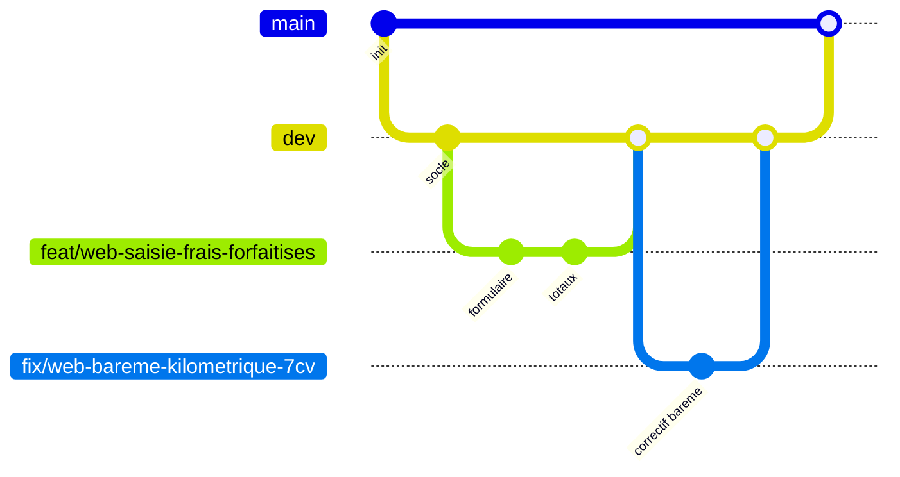

# Contribuer au projet GSB

Ce document décrit la façon dont nous travaillons à deux sur ce dépôt : branches, messages de commit,
relecture croisée et vérifications avant de pousser. Il s'adresse à Louis et Romain, personne d'autre.

## Branches

Trois niveaux, pas davantage.

- **`main`** : toujours fonctionnelle. C'est la branche que l'on montre en soutenance ou à l'enseignant.
  On n'y pousse jamais directement. Elle ne reçoit que des fusions depuis `dev`.
- **`dev`** : branche d'intégration. C'est là que les fonctionnalités se rejoignent et que l'on vérifie
  que le web, le mobile et la base restent cohérents entre eux.
- **`feat/...` et `fix/...`** : une branche par sujet. Elle part de `dev` et elle y retourne.

### Convention de nommage

`type/portee-sujet-court`, en minuscules, mots séparés par des tirets.

| Branche | Sujet |
| --- | --- |
| `feat/web-saisie-frais-forfaitises` | écran de saisie des quantités forfaitisées côté Symfony |
| `feat/mobile-file-attente-sync` | file d'attente locale et bouton de synchronisation |
| `feat/supabase-rls-comptable` | policies RLS de lecture globale pour le comptable |
| `fix/web-bareme-kilometrique-7cv` | correctif de calcul du barème pour 7 CV et plus |
| `docs/modele-donnees` | mise à jour du modèle de données |

Une branche reste courte. Si elle vit plus de quelques jours, elle diverge de `dev` et la fusion devient pénible.



## Messages de commit

Nous suivons la convention **Conventional Commits**. Forme générale :

```
type(portee): description
```

La portée est optionnelle mais nous la mettons dès que le changement concerne une seule partie du dépôt.

### Types utilisés

| Type | Usage |
| --- | --- |
| `feat` | nouvelle fonctionnalité visible par l'utilisateur |
| `fix` | correction d'un comportement erroné |
| `docs` | documentation seule, sans changement de code |
| `style` | mise en forme, indentation, nommage, sans effet fonctionnel |
| `refactor` | réécriture interne à comportement constant |
| `test` | ajout ou modification de tests |
| `chore` | tâches d'entretien : dépendances, configuration, outillage |
| `build` | build, conteneurs, migrations d'environnement |

### Portées propres au dépôt

`web` (Symfony), `mobile` (Flutter), `supabase` (SQL, RLS, seed), `docs` (dossier de documentation).

### Exemples

Ces exemples décrivent des changements prévus au projet ; l'historique n'en compte encore aucun.

```
feat(supabase): créer les lignes forfaitisées à zéro à l'ouverture d'une fiche
feat(mobile): ajouter la file d'attente locale de synchronisation
fix(web): corriger le taux kilométrique 7 CV et plus en diesel
docs: rédiger le modèle de données et le cahier des charges
refactor(web): extraire le calcul des totaux dans un service dédié
chore(mobile): configurer le proxy HTTP de la salle
```

### Règles

- Verbe à l'infinitif : « ajouter », pas « ajouté » ni « ajout ». C'est l'usage courant des messages
  de commit rédigés en français, là où l'anglais emploie l'impératif.
- Pas de majuscule en début de description.
- Pas de point final.
- Première ligne sous 72 caractères. Le détail va dans le corps du message, après une ligne vide.
- Description en français, accents compris. Git enregistre les messages en UTF-8 : les accents ne
  posent pas de problème d'encodage et un message accentué se lit mieux.

Pourquoi cette convention : l'historique se lit d'un coup d'œil et le changelog se déduit directement des
types, ce qui est un point défendable en soutenance.

## Relecture entre nous deux

- Toute fusion vers `dev` passe par une **pull request**. Pas de fusion locale poussée en douce.
- L'autre membre du binôme relit et approuve. Personne ne fusionne sa propre pull request sans relecture.
- Ce que le relecteur vérifie :
  - le projet compile ou s'exécute (`symfony console` démarre, `flutter run` démarre, les migrations passent) ;
  - le code est compréhensible sans explication orale ;
  - la documentation a suivi si le comportement change ;
  - aucun secret n'a été commité (clé Supabase, `.env`, jeton).

### Règle de déblocage

Si l'autre membre du binôme n'est pas disponible sous 24 heures et que la branche bloque le reste du travail, on fusionne
en laissant un commentaire sur la pull request expliquant pourquoi, et la relecture se fait après coup.
Cette règle existe parce que deux étudiants ne forment pas une équipe à plein temps : mieux vaut une exception
écrite et assumée qu'une règle que l'on contourne en silence.

## Répartition du travail

La répartition des tâches entre Louis et Romain est tracée dans le diagramme de Gantt du dossier `/docs`.
Chacun reste responsable de ses commits : l'historique Git sert de preuve de contribution individuelle
lors de la soutenance.

## Avant de pousser

- [ ] Aucun secret dans le diff (clés Supabase, `.env`, jetons, mots de passe).
- [ ] La documentation a suivi si le comportement a changé.
- [ ] Le message de commit respecte la convention (type, portée, infinitif, pas de point final).
- [ ] La branche part bien de `dev` et porte un nom conforme.
- [ ] Le projet compile ou s'exécute en local.
