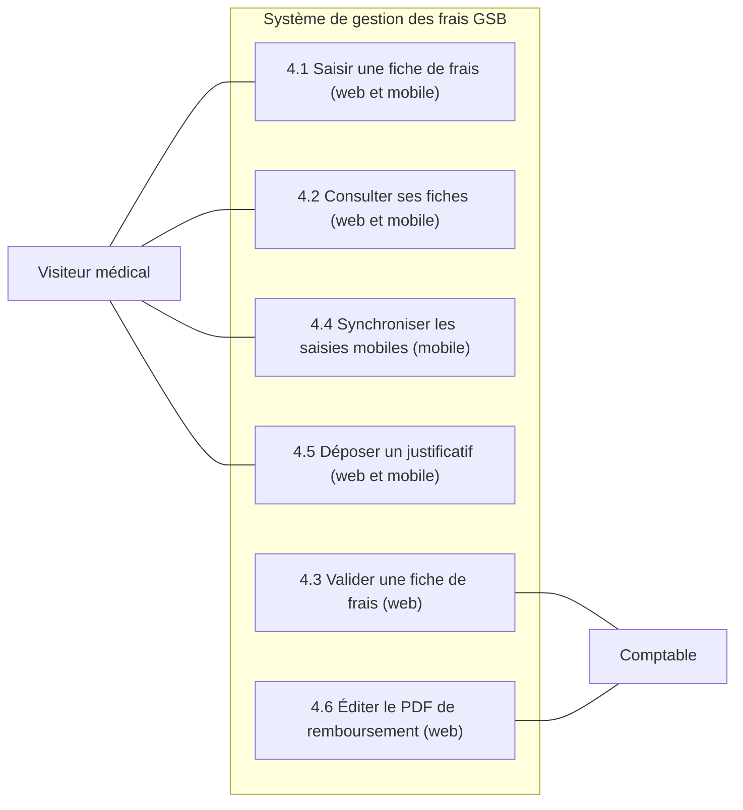
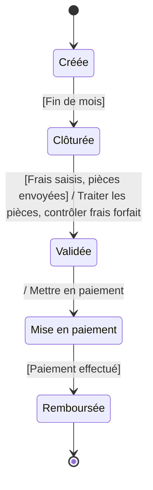
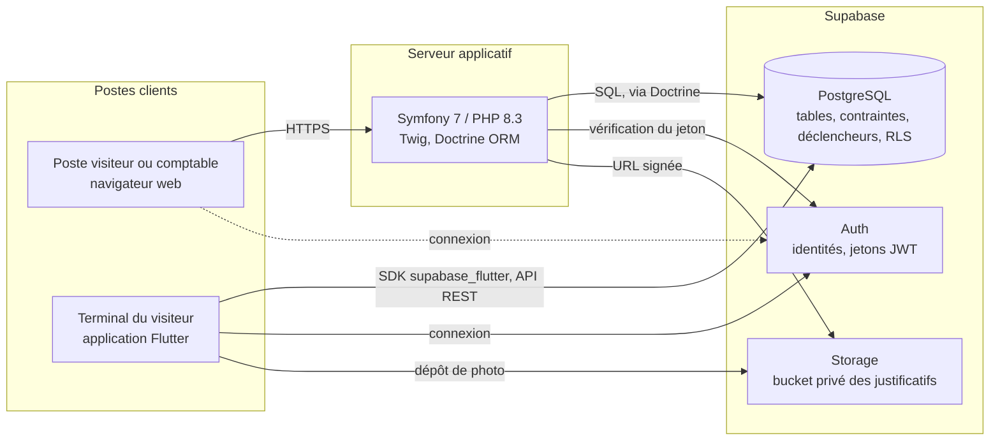

# Cahier des charges

**Projet** : GSB — Gestion des frais de mission des visiteurs médicaux
**Contexte** : Galaxy Swiss Bourdin, contexte pédagogique du réseau CERTA
**Formation** : BTS SIO 2, option SLAM — atelier de professionnalisation
**Auteurs** : Louis et Romain
**Version** : 1.0 — cadrage soumis à validation (17 points restent ouverts, section 8.1)
**Sources** : `_sources/ap-gsb-web.pdf`, `_sources/GSB_Android.pdf`, code historique de 2013

---

## Sommaire

1. [Contexte et objectifs](#1-contexte-et-objectifs)
2. [Acteurs](#2-acteurs)
3. [Périmètre fonctionnel](#3-périmètre-fonctionnel)
4. [Cas d'utilisation](#4-cas-dutilisation)
5. [Règles de gestion](#5-règles-de-gestion)
6. [Cycle de vie d'une fiche de frais](#6-cycle-de-vie-dune-fiche-de-frais)
7. [Contraintes techniques](#7-contraintes-techniques)
8. [Hors périmètre](#8-hors-périmètre)

### Comment lire ce document

Les règles de gestion de la section 5 sont numérotées `RG1` à `RG60`. Les autres sections y renvoient
par ce numéro, entre parenthèses. Les fonctionnalités de la section 3 sont numérotées `F1` à `F45`.
Les points laissés ouverts sont signalés **À ARBITRER** dans le corps du texte et rassemblés dans le
tableau `A1` à `A17` de la section 8.1.

Trois origines de règle sont distinguées dans les sections 5 à 8 — la colonne « Origine » du tableau des fonctionnalités, définie en 3.1, obéit à une autre nomenclature —, parce que la distinction est défendable
et que les confondre serait une faute d'analyse :

| Mention | Signification |
| --- | --- |
| *cahier des charges* | Le client l'écrit dans le document source. |
| *arbitrage client* | Le client a tranché lors de la réunion de cadrage un point que le document laissait ouvert. |
| *hypothèse* | Aucune source ne le donne. Nous avons posé une valeur de travail, à confirmer. |

---

## 1. Contexte et objectifs

### 1.1 Le laboratoire

Galaxy Swiss Bourdin (GSB), laboratoire pharmaceutique né du rapprochement d'un laboratoire
américain et d'un laboratoire suisse, emploie des visiteurs médicaux, salariés itinérants qui
présentent les produits aux praticiens : déplacements permanents, déjeuners en clientèle, nuits
d'hôtel, longues distances en véhicule personnel. Le laboratoire rembourse ces dépenses, seul
domaine traité ici. GSB est un **contexte pédagogique du réseau CERTA** (BTS SIO) : pas un client
réel, aucune donnée d'entreprise existante ; le « client » est l'enseignant, qui doit valider la
maquette « avant de vous lancer dans le développement ».

### 1.2 L'enjeu de la gestion des frais

« Grand poste de dépense », la gestion des frais de déplacement « demande un suivi très précis » :
près de 25 millions d'euros par an. Le client veut contenir ce poste sans « limiter les visiteurs à
des hôtels de second ordre ou des repas chiches », l'image de marque et la motivation des équipes
étant en jeu.

D'où le forfait. Les prix d'hébergement et de restauration variant fortement selon les lieux et les
régions, rembourser au réel supposerait de contrôler chaque facture, une par une, pour des montants
unitaires faibles. GSB a donc « procédé à une évaluation statistique permettant de dégager un
montant forfaitaire dans la fourchette haute des dépenses pour chaque type de frais standard ». Ce
positionnement garantit qu'un visiteur **qui se loge et se restaure dans les conditions retenues par
l'étude** est rarement perdant : plus de motif de contestation, plus de justificatif au cas par cas
(RG9, RG10, RG14).

Quatre frais standard sont forfaitisés : repas de midi, relais étape (nuit plus repas), nuitée
(hôtel seul), kilométrage (RG10). Les péages sont exclus, chaque visiteur ayant un badge de
télépéage, « pour éviter le remboursement de ces petits montants » (RG22). Le reste — repas avec un
spécialiste lors d'une animation, fournitures, réservation de salle — est remboursé au réel sur
facture acquittée : les frais hors forfait (RG23, RG25). Remboursement mensuel, sur une fiche unique
identifiée par le visiteur et le mois (RG1, RG2).

> **À ARBITRER** — Les montants unitaires du repas de midi, de la nuitée et du relais étape ne
> figurent nulle part dans le corps du cahier des charges. Les valeurs retenues dans ce document
> (29,00 €, 80,00 € et 110,00 €) sont une hypothèse de travail, à confirmer auprès du client. Seul
> le barème kilométrique est imposé par le cahier des charges (RG16).

### 1.3 La situation actuelle

**Le processus papier.** Au plus tard le 20 du mois, le service comptable adresse à chaque visiteur
la fiche du mois en cours (modèle en Annexe 1) ; celui-ci la remplit à la main, y porte quantités
forfaitisées et frais hors forfait, joint ses factures acquittées. Les agents comptables y reportent
le matricule et la date (année/mois) de prise en charge, puis les classent chronologiquement en
pochette nominative. Entre le 10 et le 20 du mois suivant la saisie, le comptable contrôle la
cohérence des quantités — jours déclarés compatibles avec les jours travaillés, distance plausible,
recoupement avec les comptes rendus de visite ; aucune règle ne formalise ce contrôle, RG34 ne
fixant que la fenêtre de validation. Tout écart se règle par téléphone, les valeurs étant corrigées
« sans que ne soit conservée trace de la modification » (RG37). Les frais hors forfait sont acceptés
ou refusés ligne par ligne : « un frais non validé est supprimé », le visiteur est informé, sans
enregistrement de la raison (RG38, RG40, RG41). Paiement au 20 du mois suivant la saisie (RG44).
Trois défauts : délais tenus à la main, aucune trace des contrôles, ressaisie tardive de dépenses
engagées des semaines plus tôt.

**L'existant informatique.** Un développement interne a été interrompu, son développeur « envoyé
immédiatement sur un autre projet de plus grande envergure ». L'archive comprend une base MySQL, une
application PHP en MVC (modèle-vue-contrôleur) où le visiteur se connecte, saisit sa fiche du mois
courant et consulte les mois précédents, et un script de données aléatoires pour les tests. Une
application Android, amorcée dans un second document, offre un menu de catégories, la saisie du
kilométrage, celle d'un frais hors forfait au jour le jour et la consultation des frais hors forfait
du mois, en persistance locale par sérialisation ; sans authentification, sans envoi au serveur,
sans relais étape.

**Ce que l'existant ne couvre pas :**

1. **Aucun module comptable** — « la partie comptable de l'application n'a pas encore été effectué » : ni acteur, ni compte, ni écran, le code n'authentifiant qu'un visiteur.
2. **Aucun calcul** — quantités enregistrées, sans montant de ligne forfaitisée ni total de fiche (RG7, RG21).
3. **Aucun justificatif** — les factures acquittées restent sur papier, alors que le remboursement hors forfait en dépend (RG25).
4. **Aucune puissance fiscale** — taux unique de 0,62 €/km quel que soit le véhicule, que la direction a décidé, « suite à certaines plaintes », d'indexer sur la puissance fiscale et le carburant (RG16) ; le véhicule n'est stocké nulle part.
5. **Cycle de vie tronqué** — seuls « créée » et « clôturée » sont posés ; `getLesFichesValidees()` filtre sur « validée » qu'aucun traitement ne positionne, et « validée », « mise en paiement », « remboursée », présentes au diagramme d'états, ne sont jamais atteintes (RG5, RG6).

### 1.4 Objectifs du projet

Chaque objectif est vérifiable par une démonstration en recette.

#### Objectifs de reprise de l'existant

| N° | Objectif | Vérification | Règles |
| --- | --- | --- | --- |
| O1 | Authentifier le visiteur avant tout accès à ses données | Accès sans session authentifiée refusé, web et mobile | RG56, RG57 |
| O2 | Saisir les quantités forfaitisées du mois | Quatre catégories saisissables, fiche créée à zéro | RG3, RG9, RG11, RG12, RG13 |
| O3 | Déclarer un frais hors forfait (date, libellé, montant) | Ligne complète enregistrée et rattachée à une fiche | RG23, RG24, RG27 |
| O4 | Consulter les mois précédents en lecture seule | Fiche clôturée affichée sans être modifiable | RG33, RG46 |
| O5 | Clôturer automatiquement le mois échu | Fiche N-1 clôturée à la première saisie du mois N | RG30, RG31 |

#### Objectifs d'évolution demandés par le client et objectifs induits par notre architecture

| N° | Objectif | Vérification | Règles |
| --- | --- | --- | --- |
| O6 | Calculer le montant de chaque ligne et le total | Total = lignes forfaitisées valorisées + hors forfait non refusés | RG7, RG8, RG10 |
| O7 | Indexer le kilométrique sur puissance fiscale et carburant | Deux véhicules de puissances différentes, même kilométrage, montants différents | RG16, RG21 |
| O8 | Historiser le véhicule du visiteur, saisi par lui-même | Changement en cours d'année : fiches antérieures inchangées | RG17, RG18, RG19 |
| O9 | Bloquer la saisie kilométrique sans véhicule déclaré | Saisie refusée, message de complément du profil, aucun taux par défaut | RG20 |
| O10 | Déposer et consulter les justificatifs hors forfait | Facture téléversée, puis consultée par le comptable | RG25, RG26 |
| O11 | Ouvrir l'application au comptable, sur tous les visiteurs | Comptable authentifié accédant à n'importe quelle fiche | RG35, RG58 |
| O12 | Corriger les quantités d'une fiche clôturée | Correction enregistrée sans trace, total recalculé | RG36, RG37 |
| O13 | Refuser une ligne hors forfait par suppression logique | Ligne hors vue du visiteur et hors totaux, sans motif enregistré | RG38, RG39, RG40, RG41 |
| O14 | Conduire la fiche jusqu'à remboursée, sans retour arrière | Cinq états linéaires, toute tentative de retour refusée | RG5, RG6, RG42, RG43, RG44, RG45 |
| O15 | Reporter les pièces reçues après le 10 sur le mois suivant | Pièce reportée, mois d'origine visible | RG28, RG29, RG54 |
| O16 | Éditer la fiche en PDF, à l'unité et en lot | Une fiche imprimée, puis toutes les fiches clôturées du mois précédent | CdC, « Génération PDF des remboursements de frais » |
| O17 | Synthétiser l'année écoulée pour le visiteur | Douze lignes, montant remboursé et nombre de prestations | RG46, RG47 |
| O18 | Saisir sur mobile au fil de l'eau, hors connexion | Saisie sans réseau conservée localement, non perdue | RG48, RG49 |
| O19 | Synchroniser le mobile, explicitement et idempotent | Synchronisation rejouée deux fois sans doublon hors forfait | RG50, RG51, RG52, RG55 |
| O20 | Traiter une saisie mobile visant un mois verrouillé | Forfait rejeté et maintenu en file, hors forfait basculé sur le mois courant | RG53, RG54 |
| O21 | Appliquer les habilitations en base, pas seulement en interface | Requête directe hors périmètre refusée par la base | RG59, RG60 |

### 1.5 Périmètre du présent document

**Couvert** : le domaine des frais de mission décrit par le cahier des charges ; les acteurs, leurs
droits et interdictions (section 2) ; les cas d'utilisation, sur le modèle de l'Annexe 2 ; les
règles RG1 à RG60, qui font foi pour le développement ; les points à confirmer auprès du client, en
fin de document. Web Symfony et mobile Flutter sont couverts indifféremment : règles communes, mise
en œuvre différente.

**Non couvert** : le modèle de données — tables, colonnes, clés, contraintes, sécurité au niveau des
lignes — décrit dans `docs/modele-donnees.md` (*non encore rédigé, il arrive à l'étape suivante*) ;
l'architecture technique détaillée (bundles Symfony, widgets Flutter, tests, déploiement) ; les
maquettes et la charte graphique, livrables distincts, celle de l'interface de validation devant
être soumise au client avant tout développement ; le planning, objet d'un diagramme de Gantt ; la
notice utilisateur ; les autres domaines GSB — rapports de visite, praticiens, secteurs, produits et
échantillons — cités comme éléments de preuve ou de contrôle, non informatisés ici.

**Environnement** : développement pour partie en salle de cours, derrière un proxy HTTP
172.16.63.130 sur le port 3128 ; toute dépendance Composer, pub ou npm doit être configurée en
conséquence.

---

## 2. Acteurs

Le système ne connaît que deux acteurs, correspondant aux deux rôles applicatifs définis par la
règle RG58 : le visiteur médical et le comptable. Les autres intervenants cités restent extérieurs
au système (section 2.4).

### 2.1 Le visiteur médical

Salarié itinérant du laboratoire, il présente les produits GSB aux praticiens de son secteur et
engage des frais de trajet, de repas et de nuitée. Son besoin est double, ce qui justifie deux
applications. Enregistrer une dépense au moment où il l'engage, en quelques secondes, éventuellement
sans réseau : c'est l'application mobile, décrite par le document Android comme « une sorte de mémo
qui permet d'enregistrer l'information à tout moment ». Relire sa fiche complète en fin de mois, y
joindre ses factures et suivre son remboursement : c'est l'application web. La règle RG57 impose une
identité unique pour ces deux usages, de sorte qu'une dépense ne soit jamais saisie deux fois.

#### Ce qu'il peut faire

- s'authentifier sur le web et sur le mobile avec le même compte (RG56, RG57) ;
- consulter et modifier sa fiche du mois courant tant qu'elle est à l'état Créée (RG13) ;
- saisir les quantités forfaitisées des quatre catégories, en entiers positifs ou nuls
  (RG9, RG11, RG12) ;
- déclarer un frais hors forfait avec sa date d'engagement, son libellé et son montant (RG23, RG27) ;
- déposer la facture acquittée qui justifie un frais hors forfait (RG25) ;
- déclarer et mettre à jour son véhicule : puissance fiscale, carburant, période de validité
  (RG18, RG19) ;
- saisir des frais engagés jusqu'à un an en arrière (RG4) ;
- saisir hors connexion sur mobile, puis déclencher lui-même la synchronisation (RG48, RG49) ;
- consulter ses fiches des mois précédents en lecture seule, avec leur état, leur montant remboursé
  et leur nombre de prestations, sur l'année écoulée (RG33, RG46, RG47) ;
- prendre connaissance du refus d'un de ses frais hors forfait (RG41).

#### Ce qu'il ne peut pas faire

- accéder à la fiche, au véhicule ou aux justificatifs d'un autre visiteur (RG59, RG60) ;
- modifier une fiche qui n'est plus à l'état Créée, y compris pour corriger une erreur de bonne foi
  (RG33, RG43) ;
- valider sa propre fiche, la mettre en paiement ou la marquer remboursée : ces transitions
  appartiennent au comptable (RG42, RG44, RG45) ;
- saisir un kilométrage tant qu'aucun véhicule n'est déclaré ; la saisie est bloquée et aucun taux
  par défaut n'est appliqué (RG20) ;
- se faire rembourser un péage, couvert par le badge de télépéage (RG22) ;
- connaître par l'application la raison du refus d'un frais, aucun motif n'étant enregistré (RG40) ;
- modifier le barème kilométrique ou les montants forfaitaires, référentiel d'entreprise
  (RG10, RG16).

### 2.2 Le comptable

Agent sédentaire du service comptable, il traite les fiches de tous les visiteurs, sans découpage
par secteur ni par région (RG35). Son travail est cadencé par le calendrier : la campagne de
validation s'ouvre après la clôture du mois, les contrôles se déroulent entre le 10 et le 20 du mois
suivant la saisie, et la mise en paiement intervient au 20 (RG34, RG44).

**Cet acteur n'existe pas du tout dans l'existant informatique** : « la partie comptable de
l'application n'a pas encore été effectué ». Le code du prédécesseur n'authentifie que des visiteurs,
ne connaît aucun rôle et ne pose jamais l'état « validée » ; il n'en subsiste que deux vestiges
inutilisables, un lien « Valider les frais » resté dans le menu et une requête
`getLesFichesValidees()` filtrant sur l'état « VA ». Aucun écran, aucun contrôleur :
**la totalité des écrans du comptable est à concevoir**, du tableau de bord de campagne à l'édition
PDF. C'est la part la plus lourde du projet côté web, et celle pour laquelle le client exige une
maquette validée avant tout développement.

#### Ce qu'il peut faire

- s'authentifier sur l'application web (RG56, RG58) ;
- consulter les fiches de tous les visiteurs, quel que soit leur état (RG35) ;
- consulter le détail d'une fiche : lignes forfaitisées, lignes hors forfait et justificatifs
  déposés (RG26) ;
- corriger les quantités forfaitisées d'une fiche à l'état Clôturée, sans qu'aucune trace de la
  modification soit conservée (RG36, RG37) ;
- refuser une ligne de frais hors forfait, ligne par ligne, par suppression logique (RG38, RG39) ;
- informer le visiteur du refus (RG41) ;
- faire passer une fiche clôturée à l'état Validée (RG42) ;
- mettre en paiement une fiche validée, puis la marquer remboursée une fois le virement exécuté,
  sous réserve de l'arbitrage A9 sur le déclencheur de ces deux transitions (RG44, RG45) ;
- consulter en lecture seule le véhicule déclaré par un visiteur, pour vérifier le taux kilométrique
  appliqué (RG17) ;
- éditer une fiche en PDF, et générer d'un seul clic toutes les fiches clôturées du mois précédent.

#### Ce qu'il ne peut pas faire

- modifier une fiche à l'état Créée, encore ouverte à la saisie du visiteur (RG36) ;
- modifier une fiche à partir de l'état Validée, immuable pour tous, y compris pour lui (RG43) ;
- faire revenir une fiche à un état antérieur : le cycle est strictement linéaire (RG6) ;
- modifier le véhicule d'un visiteur, saisi et maîtrisé par le visiteur seul (RG19) ;
- modifier le montant ou le libellé d'un frais hors forfait : il l'accepte ou il le refuse ;
- enregistrer un motif de refus (RG40) ;
- utiliser l'application mobile, réservée aux visiteurs (RG58).

### 2.3 Tableau récapitulatif des droits

| Action | Visiteur | Comptable |
| --- | --- | --- |
| Se connecter à l'application web | oui (RG56) | oui (RG56) |
| Se connecter à l'application mobile | oui (RG57) | non (RG58) |
| Consulter une fiche de frais | ses fiches uniquement (RG59) | toutes les fiches, tous les visiteurs (RG35) |
| Créer la fiche du mois courant | oui, implicitement à la première saisie (RG1, RG3) | non |
| Saisir ou modifier une quantité forfaitisée | ses fiches à l'état Créée (RG12, RG13) | fiches clôturées uniquement (RG36, RG37) |
| Ajouter un frais hors forfait | ses fiches à l'état Créée (RG23, RG24) | non — **À ARBITRER** |
| Déposer un justificatif | ses fiches à l'état Créée (RG25) | non |
| Consulter un justificatif | ses fiches uniquement (RG59) | toutes les fiches (RG26, RG35) |
| Refuser une ligne hors forfait | non | fiches clôturées uniquement (RG38, RG39) |
| Clôturer une fiche | non, clôture automatique (RG30, RG31) | par le script de campagne (RG32) |
| Valider une fiche | non | fiches clôturées uniquement (RG42) |
| Mettre une fiche en paiement | non | fiches validées uniquement (RG44) |
| Marquer une fiche remboursée | non | fiches en paiement uniquement (RG45) |
| Modifier une fiche validée ou au-delà | non (RG43) | non (RG43) |
| Déclarer ou modifier un véhicule | le sien uniquement (RG18, RG19) | non, consultation seule (RG17) |
| Consulter l'historique sur l'année écoulée | ses fiches uniquement (RG46) | toutes les fiches (RG35, RG46) |
| Éditer une fiche en PDF | **À ARBITRER** | oui, à l'unité et en lot mensuel |
| Synchroniser des saisies mobiles | ses fiches uniquement (RG49, RG50) | non (RG58) |
| Consulter le barème et les montants forfaitaires | oui, en lecture seule (RG10, RG16) | oui, en lecture seule (RG10, RG16) |
| Modifier le barème ou les montants forfaitaires | non | non — **À ARBITRER** |

> **À ARBITRER** — Trois droits ne sont tranchés par aucune source.
> **(a)** Le comptable peut-il créer une ligne de frais hors forfait pour le compte d'un visiteur ?
> Les éléments reçus après le 10 « seront basculés automatiquement sur la fiche du mois suivant leur
> saisie […] par les comptables », sans préciser s'il ressaisit la pièce. Nous retenons le traitement
> automatique (RG28, RG54).
> **(b)** Le visiteur a-t-il accès à l'édition PDF de sa propre fiche ? Le cahier des charges
> n'attribue cette fonction qu'au service comptable, pour ses archives papier.
> **(c)** Qui administre le référentiel des montants forfaitaires et du barème kilométrique ? Aucun
> acteur administrateur n'est décrit ; ce référentiel est traité comme une donnée de paramétrage
> modifiée hors application.

> **À ARBITRER** — Aucune source ne décrit la création, la désactivation ni la réinitialisation des
> comptes utilisateurs, visiteurs comme comptables ; le cahier des charges évoque seulement « les
> identifiants à leur disposition ». La gestion des comptes est supposée externe, opérée dans la
> console d'administration Supabase.

> **À ARBITRER** — Le déclenchement du script de clôture de campagne (RG32) n'est pas attribué :
> « un script est lancé », sans dire par qui ni comment. Deux options : un bouton dans l'espace
> comptable, ou une tâche planifiée. Le tableau retient provisoirement l'action du comptable.

### 2.4 Acteurs cités mais hors système

**Le délégué régional.** Il exerce un contrôle a posteriori — « Des contrôles réguliers sont faits
par les délégués régionaux qui peuvent donner lieu à des demandes de remboursement de trop perçu par
le visiteur. » — sur les pièces conservées trois ans par le visiteur (RG15) et sur les rapports de
visite, hors périmètre ; il n'intervient jamais dans le cycle de vie de la fiche.

> **À ARBITRER** — Le délégué régional doit-il disposer d'un accès en consultation aux fiches de
> son équipe, et le trop-perçu qu'il constate doit-il être tracé dans l'application ? Le cahier des
> charges ne prévoit ni l'un ni l'autre. Aucun troisième rôle n'est créé en l'état (RG58).

**Le service comptable en tant qu'organisation.** Ses actes collectifs — adresser la fiche de
demande de remboursement, conserver les documents annotés, classer les factures « dans une pochette
nominative pour chaque visiteur » — ne sont pas des actions d'utilisateur : le système ne connaît
que les agents authentifiés sous le rôle comptable défini en 2.2.

**La banque ou le service de paie.** Le virement est exécuté hors application, l'état Remboursée
étant atteint sur l'événement externe « [Paiement effectué] » ; le système n'émet aucun ordre de
virement et n'en reçoit aucun accusé, il enregistre seulement que le paiement a eu lieu (RG45).

---

## 3. Périmètre fonctionnel

### 3.1 Lecture du tableau

Le tableau 3.2 recense les fonctionnalités des deux applications, sur six colonnes.

- **N** : identifiant F1 à F45, continu, référencé au découpage en lots (3.4) et dans la suite du dossier.
- **Fonctionnalité** : service rendu à un acteur, formulé du point de vue de l'utilisateur et non du code ; il peut mobiliser plusieurs écrans.
- **Cible** : « Web » (Symfony), « Mobile » (Flutter), « Web + Mobile » quand le service existe des deux côtés — non un double développement à l'identique : même base Supabase, mêmes règles de gestion, ergonomie différente.
- **Acteur** : « Visiteur », « Comptable » ou « Les deux », chacun sur son périmètre de données (RG59, RG60).
- **Priorité** : MVP ou Évolution, à l'exclusion de tout autre niveau.
- **Origine** : *Existant*, déjà rendue par l'application PHP de 2013 fournie en archive ou par l'application Android, reprise sans régression mais redéveloppée sur la nouvelle architecture ; *Demande client*, ajoutée par le cahier des charges, dont cinq demandes structurantes isolées en 3.3 ; *Projet*, imposée par notre architecture sans demande du client (base unique attaquée par deux clients, authentification commune, saisie mobile hors ligne), à défendre par un besoin technique explicite sous peine de sortir du périmètre.

**MVP** (*minimum viable product*, périmètre minimal utilisable) : sur critère fonctionnel et non technique, les lignes sans lesquelles un visiteur ne peut plus déclarer ses frais du mois, un comptable valider une fiche, ou le cycle de vie de la fiche se poursuivre ; livré en totalité. **Évolution** : retirable sans casser le service, l'utilisateur atteignant son objectif par un chemin plus long ; non livrée, elle est signalée en soutenance.

Les montants unitaires des frais forfaitisés sont une hypothèse, à confirmer avant la recette (RG10, A1).

### 3.2 Tableau des fonctionnalités

| N | Fonctionnalité | Cible | Acteur | Priorité | Origine |
|---|---|---|---|---|---|
| F1 | Connexion par identifiant et mot de passe (RG56, RG57) | Web + Mobile | Les deux | MVP | Existant |
| F2 | Déconnexion et fermeture de la session | Web + Mobile | Les deux | MVP | Existant |
| F3 | Profil visiteur, consultation et mise à jour : identité, matricule, véhicule courant (RG19) ; hors identifiants, gérés dans la console Supabase (section 8) | Web | Visiteur | MVP | Projet |
| F4 | Rôles applicatifs et habilitations appliquées en base (RG58, RG60) | Web + Mobile | Les deux | MVP | Projet |
| F5 | Déclaration du véhicule courant : puissance fiscale, carburant, date de début (RG18, RG19) | Web | Visiteur | MVP | Demande client |
| F6 | Historisation des véhicules : clôture du précédent au changement (RG17) | Web | Visiteur | MVP | Demande client |
| F7 | Blocage de la saisie kilométrique sans véhicule renseigné (RG20) | Web + Mobile | Visiteur | MVP | Projet |
| F8 | Ouverture de la fiche du mois, lignes forfaitisées à zéro (RG1, RG3) | Web + Mobile | Visiteur | MVP | Existant |
| F9 | Saisie du nombre de repas midi (RG9, RG11, RG12) | Web + Mobile | Visiteur | MVP | Existant |
| F10 | Saisie du nombre de nuitées hôtel (RG9, RG11, RG12) | Web + Mobile | Visiteur | MVP | Existant |
| F11 | Saisie du nombre de relais étape (RG9, RG11, RG12) | Web + Mobile | Visiteur | MVP | Existant |
| F12 | Saisie du kilométrage parcouru (RG11, RG12) | Web + Mobile | Visiteur | MVP | Existant |
| F13 | Calcul kilométrique au barème du véhicule de la période (RG16, RG21) | Web + Mobile | Visiteur | MVP | Demande client |
| F14 | Ajout d'un frais hors forfait : date, libellé, montant (RG23, RG27) | Web + Mobile | Visiteur | MVP | Existant |
| F15 | Modification d'un frais hors forfait saisi | Web | Visiteur | Évolution | Projet |
| F16 | Suppression d'un frais hors forfait par le visiteur (RG13) | Web + Mobile | Visiteur | MVP | Existant |
| F17 | Consultation des frais hors forfait du mois | Web + Mobile | Visiteur | MVP | Existant |
| F18 | Dépôt de la facture acquittée sur la ligne hors forfait (RG25) ; web demandé, mobile étendu par nous | Web + Mobile | Visiteur | MVP | Demande client |
| F19 | Consultation et téléchargement des justificatifs | Web | Les deux | MVP | Demande client |
| F20 | Nombre de justificatifs pris en compte dans le remboursement (RG26) | Web | Les deux | MVP | Existant |
| F21 | Antériorité de saisie contrôlée, limitée à un an (RG4) | Web + Mobile | Visiteur | MVP | Existant |
| F22 | Verrouillage en écriture dès que la fiche quitte l'état Créée (RG13, RG33) | Web + Mobile | Visiteur | MVP | Demande client |
| F23 | Clôture automatique de la fiche précédente à la première saisie du mois suivant, tous canaux (RG30, RG31) | Web + Mobile | Visiteur | MVP | Existant |
| F24 | Script de clôture de masse des fiches non clôturées, début de campagne de validation (RG32) | Web | Comptable | MVP | Demande client |
| F25 | Consultation de la fiche du mois, de son total et de son état (RG5, RG7) | Web + Mobile | Visiteur | MVP | Demande client |
| F26 | Consultation des fiches antérieures, mois par mois | Web (mobile **à arbitrer**, voir 3.4 et 4.2) | Visiteur | MVP | Existant |
| F27 | Récapitulatif annuel : montant remboursé et nombre de prestations par mois (RG46, RG47) | Web | Visiteur | MVP | Demande client |
| F28 | Sélection d'un visiteur et d'un mois par le comptable (RG35) | Web | Comptable | MVP | Demande client |
| F29 | Détail d'une fiche : frais forfaitisés et hors forfait | Web | Comptable | MVP | Demande client |
| F30 | Correction des quantités forfaitisées par le comptable (RG36, RG37) | Web | Comptable | MVP | Demande client |
| F31 | Refus d'une ligne hors forfait, par suppression logique (RG38, RG39, RG40) | Web | Comptable | MVP | Demande client |
| F32 | Information du visiteur en cas de refus, dans l'application (RG41) — **à arbitrer, voir A10** : exclue, l'information restant un acte humain hors système (section 8) | Web | Comptable | Évolution | Demande client |
| F33 | Report automatique et tracé d'un élément reçu après le 10 sur la fiche suivante, sans le comptable (RG28, RG29 ; mobile : F45) | Web + Mobile | Visiteur | MVP | Demande client |
| F34 | Passage de la fiche à l'état Validée (RG42, RG43) | Web | Comptable | MVP | Demande client |
| F35 | Passage aux états Mise en paiement puis Remboursée (RG44, RG45) | Web | Comptable | MVP | Demande client |
| F36 | Génération du PDF d'une fiche au format de l'Annexe 1 | Web | Comptable | MVP | Demande client |
| F37 | Génération PDF en une action de toutes les fiches clôturées du mois précédent | Web | Comptable | Évolution | Demande client |
| F38 | Référentiel des catégories forfaitisées, montants unitaires à confirmer (RG10, A1) | Web | Les deux | MVP | Existant |
| F39 | Référentiel du barème kilométrique par puissance fiscale et carburant (RG16) | Web | Les deux | MVP | Demande client |
| F40 | File d'attente locale des saisies, sans écriture au fil de l'eau (RG48) | Mobile | Visiteur | Évolution | Projet |
| F41 | Bouton de synchronisation explicite, purge de la file après confirmation (RG49, RG55) | Mobile | Visiteur | Évolution | Demande client |
| F42 | Séquence PULL puis PUSH, avec résolution locale (RG50, RG51) | Mobile | Visiteur | Évolution | Projet |
| F43 | Idempotence de la synchronisation par UUID client (RG24, RG52) | Web + Mobile | Visiteur | Évolution | Projet |
| F44 | Rejet d'un frais forfaitisé visant un mois verrouillé, maintenu dans la file (RG53) | Mobile | Visiteur | Évolution | Projet |
| F45 | Bascule d'un frais hors forfait visant un mois verrouillé sur la fiche courante (RG54) | Web + Mobile | Visiteur | Évolution | Demande client |

Trois points restent **à arbitrer** dans ce tableau.

- **F18, nombre et format des justificatifs** (voir A6)**.** Le dépôt de la facture acquittée est imposé, sans dire si une ligne porte plusieurs fichiers, ni quels formats sont acceptés.
- **F32, canal d'information du visiteur.** Le visiteur doit être informé du refus, sans que soit précisé si l'information passe par l'application ou reste un appel téléphonique, comme aujourd'hui pour les litiges.
- **F38 et F39, administration des référentiels.** Aucun écran de mise à jour des montants forfaitaires ni du barème n'est demandé : à décider entre un écran, une migration de base ou une intervention technique.

### 3.3 Ce que le client demande en plus de l'existant

Cinq évolutions du cahier des charges constituent le cœur de la commande.

| Évolution | Ce qui existait | Ce qui change |
|---|---|---|
| Puissance fiscale du véhicule (F5, F6, F13, F39) | Taux unique de 0,62 EUR/km pour tous, véhicule inconnu de l'application. | Remboursement indexé sur la puissance fiscale et le carburant, barème à six taux. Le véhicule devient une donnée déclarée et historisée, pour que les fiches passées ne soient pas recalculées. |
| Dépôt des justificatifs (F18, F19) | Factures acquittées transmises sur papier au service comptable ; l'application ne stockait qu'un nombre. | La facture est déposée dans l'application, rattachée à la ligne hors forfait, et consultée à l'écran par le comptable pour décider du remboursement. Le compteur subsiste, adossé à des pièces réelles. |
| Génération PDF (F36, F37) | Fiche papier préimprimée adressée aux visiteurs, archivée sur papier. | L'application produit le PDF d'une fiche au format de l'Annexe 1, pour archivage, et génère en une action toutes les fiches clôturées du mois précédent. |
| Module comptable (F24, F28 à F35) | Aucune partie comptable : l'application de 2013 ne connaissait que le visiteur, le contrôle se faisait hors système. | Le comptable s'authentifie, choisit un visiteur et un mois, corrige les quantités forfaitisées, refuse les lignes hors forfait non justifiées, puis fait progresser la fiche jusqu'à Remboursée (cas d'utilisation de l'Annexe 2 du cahier des charges). |
| Volet mobile et synchronisation (F40 à F45) | Saisie au fil de l'eau sur Android, données sérialisées sur le téléphone, puis ressaisies sur le web. | Le visiteur saisit sur mobile et remonte ses saisies dans la base commune sans ressaisie. Le document mobile demande lui-même, en tâche 5, le code derrière le bouton de synchronisation du menu principal : nous retenons cette synchronisation explicite, déclenchée par l'utilisateur, plutôt que l'envoi direct évoqué en introduction du même document, car la saisie doit rester possible hors réseau et la remontée visible. |

### 3.4 Découpage en lots

Trois lots, chacun consommant un socle stabilisé par le précédent.

**Lot 1 — Socle visiteur sur le web.** F1 à F14, F16 à F23, F25 à F27, F38, F39, cible Web seule ; le volet mobile des lignes « Web + Mobile » va au lot 3. Il livre l'application web du visiteur, du profil au récapitulatif annuel, et pose le schéma de la base, les référentiels, l'authentification commune et le cycle de vie de la fiche. Sans lui, les autres lots n'ont pas de données à traiter. F15 y est rattachée si le calendrier le permet.

**Lot 2 — Module comptable et éditions.** F24, F28 à F31, F33 à F36 : la seconde moitié du cycle de vie, de la clôture de masse au remboursement, plus le PDF unitaire. Il vient en second car il agit sur des fiches produites par le lot 1 et sur des états que celui-ci a définis, qu'il complète sans les modifier. F32 et F37 y sont rattachées si le calendrier le permet.

**Lot 3 — Mobile et synchronisation.** F40 à F45 : l'application Flutter, la file locale et la synchronisation PULL puis PUSH, mois verrouillés compris. Il vient en dernier parce que le mobile ne définit aucune donnée, il consomme un schéma : il écrit dans les mêmes tables que le web et dépend des lignes forfaitisées créées à zéro (RG3), de l'UUID porté par la ligne hors forfait (RG24) et des états de fiche posés par les lots 1 et 2. Développer le mobile avant que ce schéma soit stabilisé reviendrait à réécrire la couche de synchronisation à chaque modification de la base. Il est aussi le seul dont l'absence ne prive le visiteur d'aucun service, puisqu'il déclare toujours ses frais sur le web : au sens du critère fonctionnel de 3.1, F40 à F45 relèvent donc de la priorité Évolution, comme les classe le tableau 3.2. Cette priorité dit seulement que le service reste rendu sans le mobile, ce qui justifie de le développer en dernier ; elle ne dit rien de son importance, l'application mobile étant un livrable attendu de l'atelier au même titre que le web.

Le rattachement du mobile au récapitulatif annuel (F27) et aux fiches antérieures (F26) reste **à arbitrer** : le document mobile ne prévoit que la consultation des frais hors forfait du mois courant.

---

## 4. Cas d'utilisation

Les six cas d'utilisation du périmètre suivent le format de la fiche fournie par le client en Annexe 2. Deux acteurs interviennent (RG58) : le **visiteur médical**, qui saisit et consulte ses propres frais sur le web et sur le mobile (RG59), et le **comptable**, qui contrôle et valide les fiches de tous les visiteurs sur le web seul (RG35). Les renvois entre parenthèses désignent les règles de gestion de la section 5.

### 4.1 Saisir une fiche de frais

| Rubrique | Contenu |
| --- | --- |
| **Nom cas d'utilisation** | Saisir une fiche de frais |
| **Acteur déclencheur** | Visiteur médical (web ou mobile) |
| **Pré conditions** | Visiteur authentifié (RG56, RG57), limité à ses données (RG59, RG60). Mois donné par le calendrier de référence (RG2) ; fiche Créée ou inexistante (RG5, RG13). Kilométrage : véhicule déclaré au profil (RG17, RG18, RG19). |
| **Post conditions** | Fiche unique par visiteur et mois (RG1), une ligne à zéro par catégorie (RG3), total recalculé (RG7). Quantités mises à jour sur la ligne (RG12), hors forfait avec identifiant client (RG24). Fiche du mois précédent passée à Clôturée (RG31). |
| **Scénario nominal** | 1. Le visiteur demande à saisir ses frais. 2. Le système détermine le mois (RG2), crée la fiche et ses lignes à zéro si besoin (RG1, RG3), clôture celle du mois précédent (RG31). 3. Il affiche quantités, hors forfait, état et total (RG5, RG7). 4. Le visiteur saisit les quantités : repas midi, nuitée, relais étape, kilométrage (RG9, RG10). 5. Le système contrôle (RG11), met à jour la ligne (RG12), calcule le kilométrique au taux du véhicule (RG16, RG17, RG21), affiche le total (RG7, RG8). 6. Le visiteur demande l'ajout d'un frais hors forfait. 7. Le système propose un formulaire : date d'engagement, libellé, montant (RG23). 8. Le visiteur saisit et valide. 9. Le système contrôle date (RG4, RG27) et montant (RG23), génère l'identifiant client (RG24), enregistre, rappelle la facture acquittée (RG25), compte les justificatifs (RG26). 10. Fin de saisie ; fiche modifiable tant qu'elle est Créée (RG13). |
| **Exceptions** | **2-a** : fiche déjà clôturée par la saisie du mois suivant (RG31) ou le script (RG32). Lecture seule (RG33) ; un hors forfait reste ajoutable, sur le mois courant (RG28). Poursuite au 6, ou fin. **5-a** : quantité non numérique. Refus, valeur conservée. Retour au 4. **5-b** : quantité négative. Refus (RG11), entier positif ou nul exigé. Retour au 4. **5-c** : kilométrage sans véhicule déclaré. Saisie bloquée (RG20), profil proposé ; aucun taux par défaut, ni l'ancien taux unique de 0,62 EUR/km. Retour au 4 après déclaration (RG19). **9-a** : date postérieure au jour courant ou antérieure de plus d'un an. Refus (RG4). Retour au 7. **9-b** : montant absent, non numérique, négatif ou nul, ou libellé vide. Refus (RG23), champ fautif signalé. Retour au 7. **9-c** : date d'un mois dont la fiche n'est plus Créée. Ligne portée sur le mois courant, date d'origine et mois_origine conservés (RG27, RG28, RG29) ; visiteur informé. Poursuite au 10. |
| **Contraintes** | Montants selon RG8. Aucun justificatif pour le forfaitisé (RG14), conservation trois ans par le visiteur (RG15). Péages exclus, jamais saisis en hors forfait (RG22). Sur mobile, les étapes 5 et 9 alimentent la file locale du cas 4.4 (RG48, RG49). |
| **Questions ouvertes** | **A ARBITRER** : montants unitaires forfaitaires, hypothèses faute de barème (29,00 EUR repas midi, 80,00 EUR nuitée, 110,00 EUR relais étape). **A ARBITRER** : plafonds et quantités maximales par catégorie, attendus mais absents. **A ARBITRER** : entrée en vigueur du barème kilométrique, fiches antérieures comprises (RG4, RG16). **A ARBITRER** : libellé hors forfait, texte libre ou liste normalisée, et longueur. |

### 4.2 Consulter ses fiches

| Rubrique | Contenu |
| --- | --- |
| **Nom cas d'utilisation** | Consulter ses fiches de frais |
| **Acteur déclencheur** | Visiteur médical (web ou mobile) |
| **Pré conditions** | Visiteur authentifié (RG56, RG57), limité à ses fiches (RG59, RG60). Aucune fiche préexistante requise : consultation des douze derniers mois, y compris sans fiche (RG46). |
| **Post conditions** | Aucune modification, aucun changement d'état (RG6). |
| **Scénario nominal** | 1. Le visiteur demande à consulter ses fiches. 2. Le système liste les mois ayant une fiche sur l'année écoulée : état, montant du remboursement, nombre de prestations (RG5, RG46, RG47). 3. Le visiteur sélectionne un mois. 4. Le système affiche le détail : lignes forfaitisées avec quantité, montant unitaire et montant (RG10), hors forfait retenus avec date, libellé et montant (RG23), justificatifs (RG26), total (RG7), état de Créée à Remboursée (RG5, RG42, RG44, RG45). 5. La fiche n'est modifiable qu'à l'état Créée (RG13), en lecture seule au-delà (RG33, RG43). 6. Le visiteur demande le récapitulatif annuel. 7. Le système affiche sur douze mois, mois par mois, le montant remboursé et le nombre de prestations (RG46, RG47). 8. Le visiteur quitte. |
| **Exceptions** | **2-a** : aucune fiche pour ce visiteur. Message d'absence, saisie du mois courant proposée (cas 4.1). Fin. **4-a** : mois sans fiche. « Pas de fiche de frais pour ce mois ». Retour au 3. **4-b** : lignes hors forfait refusées. Absentes de l'affichage et du total (RG39), sans motif (RG40) ; visiteur informé par ailleurs (RG41). Poursuite au 5. **7-a** : mois sans fiche parmi les douze. Affichés à montant nul et zéro prestation, récapitulatif continu. Poursuite au 8. |
| **Contraintes** | Nombre de prestations calculé à la volée, jamais stocké (RG47). Cloisonnement garanti en base (RG59, RG60) : nulle fiche d'autrui atteinte par une URL ou une requête. Sur mobile, vue de la dernière synchronisation, complétée des saisies en file, distinguées visuellement (RG48). |
| **Questions ouvertes** | **A ARBITRER** : le « montant du remboursement » d'une fiche non Remboursée ; nous proposons le total, dit provisoire. **A ARBITRER** : lignes reportées (mois_origine, RG29) montrées au visiteur ou réservées au comptable ? **A ARBITRER** : visiteur entré ou sorti en cours d'année, et mois sans saisie. |

### 4.3 Valider une fiche de frais

Cas fourni par le client en Annexe 2 : scénario en neuf étapes et exception 4-a conservés. Nos compléments figurent entre parenthèses ou dans les rubriques laissées vides.

| Rubrique | Contenu |
| --- | --- |
| **Nom cas d'utilisation** | Valider fiche de frais |
| **Acteur déclencheur** | Comptable |
| **Pré conditions** | Comptable authentifié (RG56, RG58), disposant des éléments d'évaluation de la conformité des frais forfaitisés. Fiches du mois achevé clôturées par script (RG32). Nos arbitrages : campagne du 10 au 20 du mois suivant (RG34) ; accès à tous les visiteurs, sans découpage par secteur (RG35) ; écriture limitée aux fiches Clôturées (RG36). |
| **Post conditions** | Le client indique « Néant ». Nos arbitrages en imposent quatre : 1. Fiche Validée, date de modification à jour (RG42). 2. Quantités corrigées enregistrées, sans trace (RG37). 3. Lignes refusées maintenues en base, hors de la vue du visiteur et des totaux (RG38, RG39), sans motif (RG40). 4. Fiche immuable pour tous (RG43). |
| **Scénario nominal** | 1. L'utilisateur comptable demande à valider les fiches de frais. 2. Le système propose de choisir le visiteur et le mois concernés. (Liste portant sur tous les visiteurs, RG35.) 3. L'utilisateur sélectionne les informations et valide. 4. Le système affiche le détail de la fiche de frais, frais forfaitisés et hors forfait. (Plus l'état, le total, les justificatifs (RG26) et le mois_origine des lignes reportées, RG29.) 5. L'utilisateur actualise les informations des frais forfaitisés. (Quantités non conformes corrigées après contact téléphonique ; entier positif ou nul, RG11.) 6. Le système indique que la modification a été prise en compte et affiche les informations actualisées. (Mise à jour de la ligne (RG12), sans trace antérieure (RG37), total recalculé (RG7).) 7. L'utilisateur demande le refus des lignes de frais hors forfait non valides. (Ligne par ligne (RG38), par suppression logique (RG39), sans motif (RG40) ; visiteur informé, RG41.) 8. L'utilisateur valide la fiche. 9. Le système passe la fiche à l'état « Validée » et met à jour la date de modification de la fiche. (Fiche immuable, plus aucune écriture possible, RG6, RG43.) |
| **Exceptions** | **4-a** : Aucune fiche de frais n'existe, le système affiche 'Pas de fiche de frais pour ce visiteur ce mois'. Retour au 2. *(exception du client, conservée à l'identique)* **4-b** : fiche non Clôturée. Créée : écriture refusée (RG36), script de clôture proposé (RG32). Validée, Mise en paiement, Remboursée : lecture seule (RG43). Retour au 2. **6-a** : quantité corrigée non entière positive ou nulle. Refus, valeur conservée (RG11). Retour au 5. **7-a** : ligne déjà refusée. Demande ignorée, aucun second enregistrement ni trace supplémentaire (RG40). Retour au 7. **7-b** : ligne hors forfait sans justificatif (RG25). Absence signalée, décision laissée au comptable : le refus n'est pas automatique. Poursuite au 7. **8-a** : état changé depuis l'affichage, par traitement concurrent. Écriture refusée (RG36, RG43), fiche rechargée. Retour au 4. |
| **Contraintes** | Rubrique laissée vide par le client. Nos arbitrages imposent : restriction d'écriture appliquée en base, pas seulement dans l'interface (RG36, RG60) ; cycle linéaire, sans retour arrière (RG6, RG43) ; aucun motif de refus enregistré (RG40), les documents annotés restant sur papier au service comptable. |
| **Questions ouvertes** | Rubrique vide chez le client, comme les Contraintes, avec « Néant » en Post conditions : ces trois rubriques sont de notre fait et doivent être confirmées. **A ARBITRER** : hors fenêtre du 10 au 20 (RG34), blocage ou avertissement. **A ARBITRER** : canal et délai d'information du visiteur en cas de refus (RG41). **A ARBITRER** : origine des données de congés et des comptes rendus de visite, éléments de contrôle sans source indiquée. **A ARBITRER** : correction d'une fiche validée à tort, sans retour arrière (RG6). **A ARBITRER** : qui déclenche Mise en paiement (RG44) et Remboursée (RG45), et comment. **A ARBITRER** : autres rôles, dont le délégué régional (contrôles, trop-perçu) ; notre modèle n'en retient que deux (RG58). |

### 4.4 Synchroniser les saisies mobiles

| Rubrique | Contenu |
| --- | --- |
| **Nom cas d'utilisation** | Synchroniser les saisies mobiles |
| **Acteur déclencheur** | Visiteur médical, depuis l'application mobile |
| **Pré conditions** | Visiteur authentifié sur le mobile, jeton valide (RG56, RG57). Saisies en attente dans la file locale (RG48). Terminal connecté au réseau. |
| **Post conditions** | Quantités forfaitisées aux valeurs du mobile (RG51) ; hors forfait présents une seule fois en base, par UUID client (RG24, RG52). Confirmés purgés de la file (RG55) ; rejetés pour fiche verrouillée maintenus en file (RG53) ou basculés sur le mois courant (RG54). Date de dernière synchronisation réussie sur le terminal. |
| **Scénario nominal** | 1. Le visiteur appuie sur Synchroniser ; aucune écriture distante n'a eu lieu avant (RG48, RG49). 2. Le mobile vérifie la connexion et le jeton, puis affiche l'avancement. 3. Phase PULL : état serveur de la fiche du mois visé, son état de cycle de vie, ses lignes (RG50). 4. Le système rapproche la file de l'état serveur : une mise à jour par catégorie forfaitisée, une insertion par hors forfait absent. 5. PUSH des quantités : par catégorie, la valeur du mobile écrase celle du serveur par mise à jour de la ligne (RG3, RG12, RG51). 6. PUSH des hors forfait : chaque ligne part avec son UUID terminal ; une ligne déjà présente sous cet identifiant n'est pas réinsérée (RG24, RG52). 7. Le serveur applique les habilitations, confirme ou rejette chaque opération (RG59, RG60). 8. Le système purge de la file les éléments confirmés, et eux seuls (RG55). 9. Il affiche le compte rendu : synchronisés, reportés, rejetés restés en file, date de dernière synchronisation réussie. |
| **Exceptions** | **2-a** : pas de réseau. Arrêt, file intacte (RG48), sans écriture partielle ; reprise sur action explicite (RG49). Fin. **2-b** : jeton expiré ou invalide. Réauthentification (RG56) puis reprise au 3 ; sinon file conservée, fin. **4-a** : kilométrage en file sans véhicule déclaré. Rejet (RG20) et maintien en file (RG19), sans taux par défaut ; les autres éléments poursuivent. Poursuite au 5. **5-a** : fiche du mois visé non Créée. Quantités forfaitisées rejetées (RG53), maintenues en file. Aucune bascule : une quantité appartient à son mois. Poursuite au 6. **6-a** : même cas, élément hors forfait. Bascule sur le mois courant, date d'origine et mois_origine conservés (RG27, RG28, RG29, RG54) ; signalé au compte rendu. Poursuite au 7. **6-b** : coupure en phase PUSH. Confirmés purgés (RG55), les autres restent ; PULL puis PUSH rejoué ensuite en entier (RG50), sans doublon ni double comptage (RG3, RG12, RG52). Retour au 1. **7-a** : écriture refusée au titre des habilitations, par exemple sur la fiche d'un autre visiteur (RG59, RG60). Élément maintenu en file, signalé rejeté. Poursuite au 8. |
| **Contraintes** | Aucune écriture en base au fil de la saisie (RG48) : la file locale est la seule mémoire jusqu'au déclenchement (RG49). Séquence toujours PULL puis PUSH (RG50). En saisie concurrente web et mobile sur une même quantité, le mobile fait foi (RG51) ; le visiteur doit en être averti, dans la notice et par un message de l'application. Le mobile attaque la base sans API : le contrôle des droits repose sur les seules politiques en base (RG60). L'idempotence tient non à un compteur ou un horodatage, mais à la mise à jour au lieu d'insertion (RG12) et à l'identifiant client (RG24). |
| **Questions ouvertes** | **A ARBITRER** : la règle « le mobile fait foi » (RG51), arbitrage de projet, aucun conflit web-mobile n'étant traité par le client. **A ARBITRER** : avertir le visiteur avant l'écrasement et lui laisser le choix ? **A ARBITRER** : conservation d'un élément rejeté en file, et comportement après plusieurs rejets. **A ARBITRER** : changement de terminal, file non vide et non transférable. **A ARBITRER** : synchronisation descendante complète, pour retrouver sur le mobile une fiche saisie sur le web ; notre PULL ne rapatrie que le nécessaire (RG50). |

### 4.5 Déposer un justificatif

| Rubrique | Contenu |
| --- | --- |
| **Nom cas d'utilisation** | Déposer un justificatif de frais hors forfait |
| **Acteur déclencheur** | Visiteur médical (web ou mobile) |
| **Pré conditions** | Visiteur authentifié (RG56, RG57), disposant de la facture acquittée (RG25). La ligne hors forfait visée existe et lui appartient (RG23, RG24, RG59). La fiche portant cette ligne est à l'état Créée (RG13). |
| **Post conditions** | Fichier stocké dans l'espace de stockage et rattaché à la ligne hors forfait. Nombre de justificatifs pris en compte mis à jour et affiché (RG26). Pièce disponible pour le comptable à la validation (cas 4.3). |
| **Scénario nominal** | 1. Le visiteur sélectionne une ligne hors forfait et demande à y déposer un justificatif. 2. Le système propose le choix d'un fichier : poste de travail sur le web, galerie ou appareil photo sur le mobile. 3. Le visiteur choisit un fichier ou photographie la facture acquittée, puis confirme. 4. Le système contrôle le format et la taille. 5. Il l'envoie vers le stockage, sous un chemin propre au visiteur et à la ligne, puis enregistre la référence sur la ligne. Sur mobile, le fichier rejoint la file locale, transmise à la seule synchronisation explicite (RG48, RG49). 6. Le système affiche le justificatif rattaché et le nombre de justificatifs pris en compte (RG26). 7. Le visiteur poursuit ou quitte l'écran. |
| **Exceptions** | **1-a** : ligne refusée (RG39), absente de la vue du visiteur, donc aucun dépôt possible ; sur lien ancien, indisponibilité signalée. Fin. **1-b** : fiche non Créée. Dépôt refusé (RG33). Fin. Tension avec le calendrier client : factures reçues au plus tard le 10 du mois suivant (RG34), donc après la clôture (RG30) ; voir questions ouvertes. **4-a** : format non accepté. Rejet, formats admis rappelés, aucun envoi engagé. Retour au 2. **4-b** : taille au-delà de la limite. Rejet, taille maximale rappelée. Retour au 2. **5-a** : échec de l'envoi, réseau ou stockage indisponible. Aucune référence enregistrée, aucun fichier partiel conservé. Retour au 3. Sur mobile, dépôt en attente, repris à la synchronisation suivante (RG49). **6-a** : ligne portant déjà un justificatif. Confirmation demandée avant remplacement. Retour au 3 ou fin. |
| **Contraintes** | Aucun justificatif pour le forfaitisé (RG14) : ce cas ne vise que le hors forfait (RG25). Le dépôt ne dispense pas de conserver les pièces trois ans (RG15). Accès au fichier restreint au propriétaire et au comptable, par les politiques en base et sur le stockage (RG59, RG60). Le compteur affiché est celui des justificatifs pris en compte dans le remboursement (RG26). Le document mobile du client n'évoque ni justificatif ni photographie : ce cas est un ajout de notre part. |
| **Questions ouvertes** | **A ARBITRER** : formats acceptés. Hypothèse : PDF, JPEG, PNG. **A ARBITRER** : taille maximale. Hypothèse : 5 Mo par fichier. **A ARBITRER** : nombre maximal de justificatifs par ligne, le lien facture-ligne n'étant pas défini. **A ARBITRER** : dépôt sur fiche clôturée (exception 1-b) ; dérogation à RG33 jusqu'au 10 du mois suivant ? **A ARBITRER** : remplacement et suppression d'un justificatif déposé. **A ARBITRER** : conservation numérique des pièces, seul le papier trois ans étant prévu (RG15). **A ARBITRER** : sur mobile, envoi immédiat de la photographie ou mise en file (RG48, RG49). |

### 4.6 Éditer le PDF de remboursement

| Rubrique | Contenu |
| --- | --- |
| **Nom cas d'utilisation** | Éditer le PDF de remboursement |
| **Acteur déclencheur** | Comptable |
| **Pré conditions** | Comptable authentifié (RG56, RG58), accédant aux fiches de tous les visiteurs (RG35). Édition unitaire : la fiche demandée existe (RG1). Édition de masse : fiches du mois précédent clôturées (RG30, RG32). |
| **Post conditions** | Un PDF par fiche, à la présentation de l'Annexe 1, remis au comptable pour l'archivage papier. Aucune donnée modifiée, aucun état changé (RG5, RG6). |
| **Scénario nominal** | 1. Le comptable demande l'édition d'une fiche de remboursement. 2. Le système propose deux modes : une fiche pour un visiteur et un mois donnés, ou l'édition de masse de toutes les fiches clôturées du mois précédent. 3. Le comptable choisit le mode unitaire, sélectionne un visiteur et un mois, puis valide. 4. Le système lit la fiche : identité et matricule du visiteur, mois, lignes forfaitisées avec quantité et montant unitaire (RG10), hors forfait retenus avec date, libellé et montant (RG23), justificatifs (RG26), total (RG7), état (RG5). 5. Il produit le PDF et le met à disposition. 6. Le comptable revient au 2 et choisit le mode de masse. 7. Le système liste les fiches éligibles, toutes les fiches Clôturées du mois précédent, tous visiteurs (RG5, RG35), et en affiche le nombre. 8. Le comptable confirme ; le système génère un document par fiche et livre le tout en une opération. 9. Il affiche le compte rendu : documents produits, fiches écartées, fiches en échec. |
| **Exceptions** | **4-a** : aucune fiche pour ce visiteur ce mois. « Pas de fiche de frais pour ce visiteur ce mois ». Retour au 2. **7-a** : aucune fiche éligible, aucune fiche du mois précédent n'étant Clôturée. Aucune génération engagée, vérification du script de clôture proposée (RG32). Fin. **8-a** : échec sur une fiche du lot, par exemple une donnée incohérente. Le lot se poursuit et n'est jamais abandonné ; la fiche est écartée, nommée au compte rendu, relançable seule ; aucun état modifié (RG6). Poursuite au 9. **8-b** : lot excédant le délai d'attente d'une requête web. Bascule en traitement différé, comptable informé de la mise à disposition ultérieure ; mode à arbitrer. |
| **Contraintes** | Lecture seule : ni l'état, ni le contenu, ni la date de modification ne changent (RG6, RG43). Montants repris tels qu'enregistrés, sans recalcul ni arrondi (RG8). Lignes refusées absentes de l'édition et du total (RG39), sans motif possible (RG40). L'Annexe 1 sert de modèle de mise en page, jamais de jeu d'essai : elle totalise 9 nuitées à 80,00 EUR à 630,00 EUR au lieu de 720,00 EUR, et applique en décembre 2010 un taux kilométrique de 0,67 EUR issu du barème institué plus tard (RG16). Constat repris dans les points à confirmer. |
| **Questions ouvertes** | **A ARBITRER** : livraison de l'édition de masse, demandée d'un clic sans précision : archive compressée, PDF fusionné ou envoi ; les trois sont réalisables. **A ARBITRER** : nommage des fichiers, pour le classement dans les pochettes nominatives. **A ARBITRER** : le visiteur peut-il éditer le PDF de sa fiche ? Le client ne le demande que pour le comptable. **A ARBITRER** : ouvrir l'édition aux fiches non Clôturées, pour un contrôle en cours de mois ? **A ARBITRER** : traitement synchrone ou différé du lot, et seuil de bascule (exception 8-b). |

### 4.7 Diagramme des cas d'utilisation

Mermaid ne propose pas de diagramme de cas d'utilisation UML. Le schéma ci-dessous en restitue la lecture par un flux de gauche à droite, les deux acteurs encadrant les six cas dans la frontière du système.

Le visiteur déclenche quatre cas, dont trois sur les deux applications et un propre au mobile ; le comptable en déclenche deux, sur le web seul, le document mobile du client ne prévoyant aucun rôle autre que le visiteur. L'authentification n'est pas un cas mais une pré condition commune aux six (RG56, RG57), appliquée en base par les habilitations (RG60).

---

## 5. Règles de gestion

Les autres sections renvoient ici par le numéro de règle (RG*n*), continu et stable de RG1 à RG60 sur neuf sous-sections. Chaque règle porte son origine : **cahier des charges** (CDC, pages 4 à 8), **arbitrage client** (AC, décision A à J de la réunion de cadrage du [date], en annexe) ou **hypothèse**, marquée **(HYPOTHÈSE à confirmer)** et reprise dans les points à confirmer. Les points ouverts sont signalés **À ARBITRER**.

---

### 5.1 Fiche de frais et calendrier

**RG1** — Unicité de la fiche de frais.
> Au plus une fiche par couple (visiteur, mois) ; ce couple (identifiant visiteur, mois AAAA-MM) identifie la fiche, sous unicité en base.
*Source : CDC, La gestion des frais de déplacement.*

**RG2** — Calendrier mensuel de référence.
> Échéances d'une fiche du mois M :
>
> | Échéance | Événement |
> | --- | --- |
> | Le 20 du mois M au plus tard | Mise à disposition du visiteur, à l'état Créée. |
> | Dernier jour du mois M | Clôture (RG30). |
> | Le 10 du mois M+1 au plus tard | Transmission au comptable des factures acquittées hors forfait. |
> | Du 10 au 20 du mois M+1 | Validation par le comptable. |
> | Le 20 du mois M+1 | Mise en paiement des fiches validées. |
>
> Tout élément reçu après le 10 du mois M+1 relève du report RG28.
*Source : CDC, Processus à informatiser, Clôture, Validation.*

**RG3** — Création de la fiche avec ses lignes forfaitisées à zéro.
> À la création, une ligne de quantité 0 par catégorie forfaitisée du référentiel (RG10) ; web et mobile les mettent à jour, jamais n'en créent (RG12).
*Source : AC, décision D.*

**RG4** — Antériorité de saisie limitée à un an.
> Date d'engagement d'un frais hors forfait saisi le jour J : entre J moins douze mois et J. Exemple du client : en août 2011, un frais engagé entre septembre 2010 et août 2011. La borne vise la date de la ligne, sans rouvrir les fiches écoulées ; un frais ancien va sur la fiche courante, à sa date d'origine (RG27, RG28).
*Source : CDC, Saisie ; articulation : AC, décisions F et G.*

**RG5** — Cycle de vie de la fiche en cinq états.
> États successifs : Créée, Clôturée, Validée, Mise en paiement, Remboursée. Toute fiche naît Créée. Aucun autre état.
*Source : CDC, diagramme d'états (page 5).*

**RG6** — Progression linéaire du cycle de vie, sans retour arrière.
> Seules transitions : Créée → Clôturée → Validée → Mise en paiement → Remboursée ; toute autre est refusée, retour arrière compris. **À ARBITRER** (aucune source) : réouverture d'une fiche clôturée à tort et annulation d'une validation, impossibles en l'état.
*Source : CDC, diagramme d'états ; AC, décision J.*

**RG7** — Total d'une fiche de frais.
> Somme des lignes forfaitisées (RG9) et des lignes hors forfait non refusées (RG39). **À ARBITRER** : total figé en base à la validation ou recalculé à l'affichage ? CDC muet ; recalcul retenu.
*Source : CDC, Annexe 1 (structure de la fiche de remboursement).*

**RG8** — Représentation des montants monétaires.
> Montants en euros, en décimal exact à deux décimales (`NUMERIC(10,2)` PostgreSQL), jamais en virgule flottante. Arrondi au centime le plus proche une seule fois, au montant d'une ligne, jamais à un total.
*Source : AC, règle de mise en œuvre (le CDC ne se prononce pas sur la représentation des montants).*

---

### 5.2 Saisie des frais forfaitisés

**RG9** — Principe du frais forfaitisé.
> Montant d'une ligne forfaitisée = quantité × montant unitaire de sa catégorie. Le visiteur saisit une quantité, jamais un montant.
*Source : CDC, Organisation des remboursements.*

**RG10** — Référentiel des frais forfaitisés.
> Quatre catégories forfaitisées, communes à tous les visiteurs, à montants unitaires identiques :
>
> | Catégorie | Code | Montant unitaire |
> | --- | --- | --- |
> | Repas midi | `REP` | 29,00 € |
> | Nuitée (hôtel seul) | `NUI` | 80,00 € |
> | Relais étape (nuit + repas) | `ETP` | 110,00 € |
> | Kilométrage | `KM` | barème RG16, en €/km |
>
> « Relais étape » est maintenue, le CDC la citant parmi les frais standard ; son absence de l'Annexe 1 et du mobile historique est une lacune de l'existant. **(HYPOTHÈSE à confirmer)** pour les trois montants : aucun barème forfaitaire au CDC, 29,00 € et 80,00 € relevés sur l'exemple de l'Annexe 1 de décembre 2010, rien pour le relais étape. **À ARBITRER** : les historiser par date d'effet, pour rééditer une fiche ancienne à l'identique ?
*Source : CDC, La gestion des frais de déplacement, pour les catégories ; hypothèse, décision B, pour les montants.*

**RG11** — Quantité forfaitisée entière, positive ou nulle.
> Entier positif ou nul ; zéro vaut absence de frais et produit 0,00 €. **À ARBITRER** : le CDC ne chiffre ni plafond, ni maximum par catégorie, ni contrôle de cohérence kilométrique.
*Source : CDC, Saisie ; AC, décision D.*

**RG12** — Mise à jour, jamais insertion, d'une ligne forfaitisée.
> Une seule ligne par couple (fiche, catégorie forfaitisée), sous unicité en base ; toute saisie de quantité, web ou mobile, met à jour la ligne existante, sans insertion après la création.
*Source : AC, décision D.*

**RG13** — Fiche modifiable par le visiteur tant qu'elle est à l'état Créée.
> Tant que sa fiche est Créée, le visiteur modifie les quantités forfaitisées, ajoute des frais hors forfait, modifie les siens (F15), les supprime (F16) ; ensuite, toute écriture du visiteur est refusée.
*Source : CDC, Saisie.*

**RG14** — Absence de justificatif pour les frais forfaitisés.
> Aucun justificatif exigé pour une ligne forfaitisée, aucun remboursement conditionné à sa production ; les rapports de visite tiennent lieu de preuve.
*Source : CDC, Organisation des remboursements.*

**RG15** — Conservation des justificatifs pendant trois ans par le visiteur.
> Le visiteur conserve trois ans ses justificatifs forfaitisés sans les transmettre ; le système ne les stocke, ne les réclame, n'en suit aucun. Les contrôles des délégués régionaux peuvent s'y appuyer et donner lieu à une demande de trop-perçu, hors système.
*Source : CDC, Organisation des remboursements.*

---

### 5.3 Barème kilométrique et véhicule

**RG16** — Barème kilométrique indexé sur la puissance fiscale et le carburant.
> Taux kilométrique selon le couple (puissance fiscale, carburant), en €/km :
>
> | Puissance fiscale | Diesel | Essence |
> | --- | --- | --- |
> | 4 CV | 0,52 | 0,62 |
> | 5 CV et 6 CV | 0,58 | 0,67 |
> | 7 CV et plus | 0,65 | 0,72 |
>
> Il remplace l'ancien taux unique de **0,62 €/km** ; aucun autre n'est admis. **À ARBITRER** : entrée en vigueur et rétroactivité, non précisées alors que la saisie remonte jusqu'à un an (RG4).
*Source : CDC, Prise en compte de la puissance fiscale d'un véhicule.*

**RG17** — Taux applicable déterminé par le véhicule de la période.
> Le taux d'une ligne kilométrique du mois M est celui du véhicule valide en M : début au plus tard le dernier jour de M, fin nulle ou au plus tôt le premier jour de M. Les fiches antérieures ne sont jamais recalculées.
*Source : AC, décision A.*

**RG18** — Un seul véhicule courant par visiteur.
> Un visiteur a au plus un véhicule à date de fin nulle, dit courant ; les périodes de validité de ses véhicules ne se chevauchent pas.
*Source : AC, décision A.*

**RG19** — Véhicule renseigné par le visiteur.
> Le visiteur crée et met à jour ses véhicules depuis son profil : puissance fiscale, carburant, dates de début et de fin. Le comptable consulte sans modifier.
*Source : AC, décision A.*

**RG20** — Blocage de la saisie kilométrique en l'absence de véhicule.
> Sans véhicule valide au mois de la fiche, toute saisie kilométrique est refusée, web comme mobile, et le visiteur invité à compléter son profil ; aucun taux par défaut, pas même l'ancien 0,62 €/km.
*Source : AC, décision A.*

**RG21** — Calcul du montant kilométrique.
> Quantité kilométrique entière, positive ou nulle ; montant = quantité × taux RG16, arrondi au centime selon RG8.
*Source : CDC, Prise en compte de la puissance fiscale d'un véhicule ; AC pour l'arrondi.*

**RG22** — Péages exclus du remboursement.
> Aucun remboursement des péages, ni au forfait ni hors forfait, chaque visiteur ayant un badge de télépéage : pas de catégorie « péage » au référentiel, et toute ligne hors forfait de péage est refusée.
*Source : CDC, La gestion des frais de déplacement.*

---

### 5.4 Frais hors forfait et justificatifs

**RG23** — Informations obligatoires d'un frais hors forfait.
> Date d'engagement, montant strictement positif et libellé non vide obligatoires ; à défaut, saisie rejetée. **À ARBITRER** : longueur maximale du libellé, liste normalisée de motifs, plafond du montant.
*Source : CDC, Organisation des remboursements.*

**RG24** — Identifiant de ligne hors forfait généré par le client.
> UUID généré par l'application créatrice, web ou mobile, avant tout envoi au serveur ; clé primaire de la ligne, deux envois de même UUID désignent la même ligne et n'en créent qu'une.
*Source : AC, décision E.*

**RG25** — Facture acquittée obligatoire, déposée dans l'application.
> Le remboursement suppose une facture acquittée, déposée par le visiteur dans l'application (Supabase Storage) et rattachée à sa ligne ; le comptable la constate avant de valider ou refuser. **À ARBITRER** : formats, taille, nombre de pièces par ligne, remplacement, conservation numérique.
*Source : CDC, Organisation des remboursements et Upload de documents.*

**RG26** — Affichage du nombre de justificatifs pris en compte.
> Pour chaque fiche, le visiteur voit le nombre de justificatifs pris en compte dans le remboursement : les lignes hors forfait non refusées portant un justificatif. **(HYPOTHÈSE à confirmer)** : le CDC exige l'affichage sans définir ce qui est compté.
*Source : CDC, Organisation des remboursements ; hypothèse pour le dénombrement.*

**RG27** — Date d'engagement indépendante du mois de la fiche.
> La date d'engagement d'une ligne hors forfait n'appartient pas nécessairement au mois de sa fiche ; seule la borne d'antériorité RG4 est contrôlée.
*Source : AC, décision G.*

**RG28** — Report des éléments reçus après le 10.
> Un frais hors forfait dont le justificatif parvient au comptable après le 10 du mois M+1, ou saisi quand la fiche de son mois n'est plus Créée, va sur la fiche courante, créée au besoin, à sa date d'engagement d'origine.
*Source : CDC, Validation (page 5) ; AC, décision F.*

**RG29** — Traçabilité du report par `mois_origine`.
> Une ligne reportée porte dans `mois_origine` le mois de sa fiche initiale, colonne nulle sinon. Le comptable la voit ; sa restitution au visiteur reste **À ARBITRER** (voir 4.2).
*Source : AC, décision G.*

---

### 5.5 Clôture

**RG30** — Clôture au dernier jour du mois.
> La fiche du mois M est clôturée au terme du mois M, de Créée à Clôturée, par l'application : aucune clôture manuelle du visiteur.
*Source : CDC, Clôture.*

**RG31** — Clôture déclenchée par la première saisie du mois suivant.
> À la première saisie d'un visiteur au titre du mois M+1, sa fiche du mois M est clôturée si elle est encore Créée.
*Source : CDC, Clôture, première modalité.*

**RG32** — Clôture déclenchée par le script de campagne.
> Au lancement de la campagne de validation du mois M, un script clôture toutes les fiches du mois M encore Créées, tous visiteurs confondus ; sans effet sur les fiches plus avancées, il est relançable.
*Source : CDC, Clôture, seconde modalité ; Annexe 2, pré-conditions.*

**RG33** — Consultation d'une fiche clôturée par le visiteur (conséquence de RG13).
> Fiche sortie de l'état Créée : le visiteur en consulte le contenu et l'évolution de l'état, sans plus la modifier. **À ARBITRER** (aucune source) : le sort d'une fiche entièrement à zéro, clôturée puis validée.
*Source : CDC, page 5.*

---

### 5.6 Validation et refus

**RG34** — Fenêtre de validation.
> Le service comptable valide les fiches du mois M entre le 10 et le 20 du mois M+1.
*Source : CDC, Validation.*

**RG35** — Le comptable accède aux fiches de tous les visiteurs.
> Un comptable lit les fiches de tous les visiteurs, sans découpage par secteur, région ou portefeuille. **À ARBITRER** (aucune source) : d'autres rôles, notamment délégué régional et administrateur.
*Source : AC, décision C.*

**RG36** — Écriture du comptable limitée aux fiches clôturées.
> Un comptable ne modifie une fiche qu'à l'état Clôturée : quantités forfaitisées, refus de lignes hors forfait, passage à Validée. Toute écriture sur un autre état est refusée.
*Source : AC, décision C.*

**RG37** — Correction des quantités forfaitisées sans conservation de trace.
> Le comptable corrige la quantité de toute ligne forfaitisée d'une fiche clôturée ; la correction remplace la valeur du visiteur, sans conserver valeur antérieure, auteur ni motif. Seule la date de modification change (RG42).
*Source : CDC, Validation.*

**RG38** — Refus ligne par ligne des frais hors forfait.
> Le comptable statue ligne par ligne : il laisse la ligne hors forfait valide ou la refuse. Le refus porte sur une ligne, jamais sur la fiche.
*Source : CDC, Validation ; Annexe 2, étape 7 du scénario nominal.*

**RG39** — Suppression logique du frais refusé.
> Une ligne refusée reste en base au statut « refusé », disparaît de la vue du visiteur et sort du total (RG7) comme du nombre de prestations (RG47) : la règle du client — « un frais non validé est supprimé » — est respectée côté utilisateur, sans perte de traçabilité.
*Source : CDC, Validation ; AC, décision I.*

**RG40** — Aucun motif de refus enregistré.
> Ni raison, ni commentaire, ni code de refus n'est enregistré : le refus se limite au changement de statut. Les documents annotés restent au service comptable, hors système.
*Source : CDC, Validation ; AC, décision I.*

**RG41** — Information du visiteur en cas de refus.
> Le comptable informe le visiteur de la suppression d'un frais non validé. **À ARBITRER** : canal (courriel, notification, téléphone) et délai non précisés ; acte hors système en l'état, comme le contact téléphonique en cas d'incohérence.
*Source : CDC, Validation.*

**RG42** — Passage à l'état Validée.
> Lorsque le comptable valide une fiche Clôturée, elle passe à Validée et sa date de modification est mise à jour.
*Source : CDC, Annexe 2, étape 9 du scénario nominal.*

**RG43** — Immuabilité de la fiche à partir de l'état Validée.
> Une fiche Validée, Mise en paiement ou Remboursée n'est modifiable par personne, visiteur ou comptable : ni lignes forfaitisées, ni hors forfait, ni justificatifs. Seule reste la transition suivante (RG6).
*Source : AC, décision C ; CDC, diagramme d'états.*

---

### 5.7 Mise en paiement et consultation

**RG44** — Mise en paiement au 20.
> Les fiches validées du mois M sont mises en paiement le 20 du mois M+1 et passent à l'état Mise en paiement.
*Source : CDC, page 5.*

**RG45** — Passage à l'état Remboursée.
> Une fiche passe de Mise en paiement à Remboursée au paiement effectué. **À ARBITRER** (aucune source) : le déclencheur — retour d'une interface bancaire, pointage manuel du comptable ou traitement automatique.
*Source : CDC, diagramme d'états.*

**RG46** — Consultation sur l'année écoulée.
> Le visiteur consulte, pour chacun des douze derniers mois, le montant remboursé par le laboratoire, le nombre de prestations (RG47) et l'état de la fiche.
*Source : CDC, page 5.*

**RG47** — Nombre de prestations d'une fiche.
> Quantités des lignes forfaitisées hors kilométrage, plus nombre de lignes hors forfait non refusées ; le kilométrage, distance et non prestation, est exclu. Calculé à la demande, non stocké. **(HYPOTHÈSE à confirmer)** : le CDC exige l'affichage sans le définir.
*Source : hypothèse, décision H.*

---

### 5.8 Synchronisation mobile

**RG48** — Aucune écriture du mobile au fil de la saisie.
> Chaque saisie va dans une file locale persistante, sans écriture en base ; elle survit à la fermeture de l'application et reste consultable hors connexion.
*Source : AC, décision E.*

**RG49** — Synchronisation explicite.
> La remontée vers la base n'a lieu que sur action explicite du visiteur, par le bouton de synchronisation ; aucune synchronisation automatique en arrière-plan.
*Source : AC, décision E.*

**RG50** — Séquence PULL puis PUSH.
> Une synchronisation lit d'abord l'état serveur des fiches concernées, résout chaque entrée de la file au regard de cet état (RG51 à RG54), puis écrit : jamais d'écriture sans lecture.
*Source : AC, décision E.*

**RG51** — Le mobile fait foi sur les quantités forfaitisées.
> La quantité transmise par le mobile remplace la valeur en base pour le couple (fiche, catégorie), même saisie depuis le web entre-temps ; jamais de cumul.
>
> Seule règle du document pouvant faire perdre une saisie, elle se justifie ainsi : le mobile porte la valeur constatée sur le terrain, ses quantités y étant saisies en valeur absolue et non par incrément — un cumul produirait un doublon à chaque synchronisation rejouée. Le refus obligerait le visiteur à arbitrer un conflit depuis son téléphone ; la règle du plus récent horodatage supposerait des horloges comparables, ce que le mode hors ligne ne garantit pas.
*Source : AC, décision E.*

**RG52** — Idempotence de la synchronisation des frais hors forfait.
> L'envoi d'un frais hors forfait est une insertion conditionnée par l'UUID client (RG24) : une ligne déjà présente sous cet UUID n'est pas réinsérée, et rejouer une synchronisation, totale ou partielle, ne crée aucun doublon.
*Source : AC, décision E.*

**RG53** — Rejet d'un frais forfaitisé destiné à une fiche verrouillée.
> Fiche du mois visé sortie de l'état Créée : le serveur rejette la mise à jour de quantité forfaitisée. Le mobile signale le mois clôturé et garde l'entrée en file, ni perdue ni reportée.
*Source : AC, décision F.*

**RG54** — Bascule d'un frais hors forfait destiné à une fiche verrouillée.
> Fiche du mois visé sortie de l'état Créée : le frais hors forfait est inséré sur la fiche courante, créée au besoin, à sa date d'engagement d'origine et `mois_origine` renseignée (RG28, RG29). Le mobile signale ce report.
*Source : AC, décisions F et G.*

**RG55** — Purge de la file après confirmation du serveur.
> Une entrée n'est retirée de la file qu'après confirmation d'écriture du serveur ; en cas d'échec réseau ou d'erreur, elle est gardée et resoumise à la synchronisation suivante, sans perte.
*Source : AC, décision E.*

---

### 5.9 Authentification et habilitations

**RG56** — Authentification préalable obligatoire.
> Toute saisie, consultation ou validation est précédée d'une authentification ; sans elle, aucun accès aux données de frais, web comme mobile.
*Source : CDC, Saisie et Réalisation partie comptable.*

**RG57** — Identité unique commune au web et au mobile.
> Un compte unique Supabase Auth sert au web comme au mobile ; les frais remontés par le mobile sont rattachés au visiteur de ce compte. **À ARBITRER** (aucune source) : politique de mot de passe, réinitialisation, durée de session.
*Source : AC (base et authentification communes) ; document mobile, tâche 5 (« vous êtes libre de la méthode à utiliser »).*

**RG58** — Deux rôles applicatifs.
> Deux rôles, visiteur et comptable ; un utilisateur en porte un seul. Le mobile n'est ouvert qu'aux visiteurs et n'expose aucune fonction comptable.
*Source : CDC, Réalisation partie comptable ; document mobile, contexte.*

**RG59** — Cloisonnement des données du visiteur.
> Un visiteur lit ses seules fiches et ses seuls justificatifs ; il n'écrit que sur les siennes, et seulement à l'état Créée (RG13).
*Source : CDC, Saisie ; AC, décision C.*

**RG60** — Habilitations appliquées en base.
> Les règles RG35, RG36, RG43 et RG59 passent par des politiques de sécurité au niveau des lignes (RLS, *row level security*) de PostgreSQL, opposables au web comme au mobile qui attaquent la base directement : l'interface n'est jamais l'unique barrière.
*Source : AC, décision C.*

---

## 6. Cycle de vie d'une fiche de frais

Le cahier des charges est explicite : « L'**état** de la fiche de frais fera l'objet d'un suivi précis
qui sera affiché lors de la consultation ». L'état n'est donc pas une donnée interne au service
comptable : c'est une information rendue au visiteur, sur chacune des fiches de l'année écoulée
(RG5, RG46). Un visiteur qui consulte sa fiche de mars doit lire immédiatement si elle est encore
modifiable, en attente de contrôle, validée, mise en paiement ou déjà remboursée. Le diagramme
ci-dessous reproduit fidèlement celui du cahier des charges, gardes et actions comprises.

Cinq états, quatre transitions, un sens de marche unique (RG5, RG6). La fiche naît à la première
saisie du mois et meurt une fois le remboursement constaté.

### 6.1 Ce que chaque état autorise

| État | Qui peut écrire | Ce qui déclenche la sortie | Règles applicables |
| --- | --- | --- | --- |
| **Créée** | Le visiteur propriétaire, depuis le web comme depuis le mobile. Le comptable n'a aucun droit d'écriture. | Fin de mois : soit la première saisie du visiteur pour le mois suivant, soit le script de campagne lancé par le service comptable. | RG1, RG2, RG3, RG4, RG11, RG12, RG13, RG23, RG24, RG25, RG27, RG48 à RG52, RG59 |
| **Clôturée** | Le comptable seul. Le visiteur passe en consultation : « les visiteurs peuvent consulter l'évolution de la fiche mais ne peuvent plus la modifier ». | Traitement des pièces et contrôle des frais forfaitisés par le comptable, entre le 10 et le 20 du mois suivant la saisie. | RG30, RG31, RG32, RG33, RG34, RG35, RG36, RG37, RG38, RG39, RG40, RG41, RG53, RG54 |
| **Validée** | Personne. La fiche devient immuable pour le visiteur comme pour le comptable. | Décision de mise en paiement prise par le service comptable, au 20 du mois. | RG42, RG43, RG7, RG47 |
| **Mise en paiement** | Personne. | Constat du paiement effectif. **A ARBITRER** : le cahier des charges ne dit pas qui ou quoi enregistre ce constat (saisie du comptable, retour d'une interface bancaire, traitement par lot). | RG43, RG44 |
| **Remboursée** | Personne. État final. | Aucune : la fiche reste consultable par le visiteur pendant l'année écoulée. | RG43, RG45, RG46 |

Deux lectures de ce tableau méritent d'être soulignées. D'abord, le droit d'écriture se
déplace du visiteur vers le comptable exactement une fois, à la clôture, et disparaît ensuite
définitivement à la validation : à aucun moment les deux acteurs ne peuvent écrire simultanément sur
la même fiche (RG13, RG36, RG43). Ensuite, la garde `[Fin de mois]` du diagramme d'origine reste une
condition logique ; le cahier des charges en donne deux traductions applicatives distinctes, la
première saisie du mois suivant et le script de campagne (RG31, RG32). Les deux aboutissent au même
état, la fiche n'est clôturée qu'une fois.

### 6.2 Absence de retour arrière

Le diagramme du client ne dessine aucune transition de retour. Nous faisons l'hypothèse, à confirmer avec le client, qu'il ne s'agit pas d'un oubli de notation :
un diagramme d'états complet, doté d'un état initial et d'un état final, qui ne trace pas de flèche
inverse, **interdit** ce retour. Le texte confirme ce sens de marche : les erreurs constatées pendant
le contrôle sont réglées par un appel téléphonique et une correction des valeurs *avant* validation,
jamais par une dévalidation. Nous retenons donc l'irréversibilité comme une règle de gestion à part
entière (RG6), et la base la fera respecter (voir section 7.3).

Cette lecture stricte laisse cependant trois situations sans solution outillée :

1. **Une fiche clôturée à tort.** Le script de campagne clôture toutes les fiches du mois traité
   (RG32). Un visiteur en retard de saisie, ou en congés au moment de la campagne, perd sa fiche
   sans recours applicatif.
2. **Une validation à annuler.** Une fois la fiche passée à Validée, elle est immuable (RG43). Une
   erreur de contrôle découverte le lendemain n'a aucun moyen d'être corrigée dans l'application.
3. **Un frais hors forfait refusé à rétablir.** Le refus est une suppression logique définitive
   (RG38, RG39) et aucun motif n'est conservé (RG40). Si le visiteur produit ensuite la facture
   manquante, rien ne permet de revenir sur le refus.

Ces trois cas sont **À ARBITRER**. Trois réponses sont possibles et elles n'ont pas le même coût :
accepter le blocage et traiter ces cas hors application ; autoriser une transition de retour
réservée au comptable, ce qui suppose une trace de l'opération et contredit la règle « sans que ne
soit conservée trace de la modification » ; ou traiter la correction par une fiche de régularisation
sur le mois courant, dans l'esprit du report des pièces reçues après le 10 (RG28). Tant que le point
n'est pas tranché, nous appliquons la lecture stricte du diagramme.

---

## 7. Contraintes techniques

### 7.1 Architecture

Le point à retenir est la flèche absente : **aucun trait entre mobile et Symfony**. Flutter attaque
Supabase via `supabase_flutter` ; les deux applications sont clients de rang égal d'une même base,
seul lieu où les contraindre identiquement. Une API intermédiaire aurait redoublé Supabase : son
absence est délibérée, au prix de la discipline du 7.3.

### 7.2 Pile technique

| Brique | Technologie | Version | Justification |
| --- | --- | --- | --- |
| Application web | Symfony, Twig | Symfony 7.x, PHP 8.3 minimum | Cadriciel PHP imposé par le contexte pédagogique ; couvre les deux profils. |
| Données côté web | Doctrine ORM | 3.x | Mappage objet-relationnel de Symfony ; schéma versionné avec la CLI Supabase. |
| Application mobile | Flutter, Dart | canal `stable` | Couvre Android sans fermer iOS (A16) ; `supabase_flutter` donne un accès direct et officiellement maintenu à la base, qu'aucune bibliothèque Android native n'égale. |
| Données côté mobile | SDK `supabase_flutter` | 2.x | Accès direct à PostgreSQL, sans API intermédiaire à développer ni maintenir. |
| Base de données | PostgreSQL, hébergé par Supabase | 15 ou supérieur | Base unique des deux clients ; réunit données, authentification, stockage et habilitations par ligne (7.3). |
| Authentification | Supabase Auth | plateforme | Identité unique au web et au mobile (RG56, RG57), sans mots de passe chez nous. |
| Justificatifs | Supabase Storage | plateforme | Bucket privé adossé aux identités et politiques de la base (RG25). |
| Habilitations | Row Level Security PostgreSQL | native | Seule habilitation valant pour le web et le mobile à la fois (RG60). |
| Édition PDF | Bibliothèque PHP tierce (Dompdf, mPDF ou KnpSnappyBundle) ; choix arrêté en conception | à figer | Impression d'une fiche et édition en un clic des fiches clôturées du mois. |
| Environnement local | Docker Desktop, CLI Supabase | Docker 4.x, CLI 2.x | Supabase complet en local, hors des données de démonstration. |
| Versionnement | Git, GitHub | 2.x | Dépôt unique : web, mobile, migrations, documentation. |

### 7.3 Conséquence architecturale majeure

Le mobile écrivant directement dans PostgreSQL, **aucune règle de gestion ne peut reposer sur un
contrôleur Symfony**, qu'il contourne par construction ; une règle en Dart ne protège rien non plus,
le web l'ignore et l'appareil échappe à notre maîtrise. **Tout invariant descend dans la base.**

- Une fiche par visiteur et par mois (RG1) : index unique.
- Quantité forfaitisée entière et positive (RG11) : contrainte `CHECK`.
- Lignes forfaitisées créées à zéro (RG3) : déclencheur à l'insertion d'une fiche.
- Cycle de vie linéaire (RG6), immuabilité dès Validée (RG43) : déclencheurs `BEFORE UPDATE`
  rejetant la transaction.
- Identifiant de ligne hors forfait généré par le client (RG24) : clé primaire `uuid` ; avec
  `ON CONFLICT DO NOTHING`, synchronisation idempotente sans dédoublonnage applicatif (RG52).
- Cloisonnement du visiteur (RG59), accès du comptable à toutes les fiches (RG35), écriture limitée
  aux fiches clôturées (RG36) : politiques RLS.

**Symfony et Flutter valident pour l'ergonomie, la base valide pour la sûreté** : le formulaire refuse
une quantité négative avec un message clair, `CHECK` sans exception. Duplication assumée ; en cas de
divergence, la base a raison et c'est l'application qu'il faut corriger.

### 7.4 Sécurité et habilitations

Authentification déléguée à Supabase Auth : un compte unique web et mobile (RG56, RG57). Le rôle,
visiteur ou comptable (RG58), est porté par la base et lu par RLS, jamais déduit du client.

| Ressource | Visiteur | Comptable |
| --- | --- | --- |
| Fiches et lignes de frais | Lecture et écriture sur ses seules fiches (RG59) | Lecture sur toutes les fiches, sans découpage par secteur (RG35) |
| Fiche Créée | Écriture pour le propriétaire (RG13) | Aucune écriture |
| Fiche Clôturée | Lecture seule (RG33) | Écriture autorisée (RG36) |
| Fiche Validée et au-delà | Lecture seule | Lecture seule : fiche immuable pour tous (RG43) |

Le mobile n'embarque que la clé publique anonyme : la décompiler livre l'URL du projet et cette clé,
aucune donnée de frais, faute de jeton authentifié. D'où RLS sur toutes les tables, vérifiée une par
une en recette ; elle vaut aussi pour Symfony, acteur non privilégié.

Justificatifs en *bucket* **privé**, sans URL publique permanente : affichage par URL signée, à la
demande, pour l'utilisateur habilité, valable un temps limité. **A ARBITRER** : sa durée. Une minute
protège au mieux mais gêne une pièce restée ouverte dans un onglet ; plusieurs heures rendent le lien
partageable hors application. Sinon, valeur prudente en configuration.

### 7.5 Hébergement et environnements

Deux environnements, un seul jeu de migrations.

- **Développement** : Supabase local sous Docker (`supabase start`) — PostgreSQL, Auth, Storage,
  Studio — sur chaque poste étudiant ; aucune donnée de démonstration touchée, schéma destructible
  et reconstructible à volonté.
- **Démonstration** : instance Supabase hébergée, mêmes migrations versionnées ; le mobile
  l'interroge le jour de la soutenance.

**A ARBITRER** : l'hébergement de Symfony pour la soutenance — poste de présentation, plateforme
gratuite (à condition de vérifier qu'elle atteint l'instance Supabase) ou hébergement de
l'établissement (à condition de connaître à l'avance la version de PHP disponible). À trancher avant
le développement : il fixe variables d'environnement et procédure de déploiement.

### 7.6 Accès réseau en salle

Internet passe par un proxy HTTP : **172.16.63.130**, port **3128**. Absente des documents du client,
l'adresse a été relevée au tableau en réunion de cadrage (photographie dans `_sources/IMG_6845.png`)
et reste à revérifier au premier poste. Sans elle, aucun téléchargement n'aboutit : Composer, `pub`,
Git, CLI Supabase. Composer, `pub` et la CLI Supabase lisent les variables d'environnement
`http_proxy` et `https_proxy` de la session ; Git se règle par sa configuration globale.

Blocage fréquent : **Docker Desktop ne lit pas les `http_proxy` du terminal**. Son démon tourne dans
sa machine virtuelle et se règle dans les préférences, rubrique ressources et proxy ; sinon
`supabase start` échoue au téléchargement des images quand `curl` marche.

Pose et retrait : `README.md` du dépôt, section « Travailler derrière le proxy de la salle ».
Réglages valables en salle seulement.

### 7.7 Navigateurs et plateformes cibles

**Web.** Dernières versions de Firefox, Chrome et Edge sur poste ; usage bureautique, rendu garanti
dès **1280 pixels de large**. **A ARBITRER** : le support d'Internet Explorer, qui interdirait les
CSS modernes, et celui de la navigation mobile sur le web — couvert par Flutter pour les visiteurs,
ouvert pour un comptable.

**Mobile.** Android prioritaire : le document du client s'intitule « PPE 3 : GSB-Android » et ne
décrit que des interfaces Android. **A ARBITRER** : le support d'iOS. Flutter compile pour les deux
plateformes depuis le même code, mais un paquet iOS exige machine Apple et compte développeur, sans
lesquels la cible n'est ni compilable ni testable.

### 7.8 Contraintes de données

Portées par le schéma PostgreSQL, elles valent pour les deux applications.

- **Montants** : `numeric` à deux décimales, `numeric(10,2)` par exemple ; **jamais de flottant**
  (`float`, `double precision`, `real`), qui ne représente pas exactement 29,00 et dont les arrondis
  se cumulent sur un total — inacceptable sur des données comptables archivées et opposables (RG8),
  là où `numeric` calcule en décimal. Même règle pour les taux du barème kilométrique (RG16).
- **Dates** : `date` pour l'engagement d'un frais hors forfait (RG23, RG27), sans heure ni fuseau.
- **Horodatages** : `timestamptz` pour toute trace technique, dont la dernière modification d'une
  fiche ; le mobile synchronise depuis le terrain, le serveur peut être ailleurs : sans fuseau, la
  comparaison n'est pas fiable.
- **Identité d'une fiche** : visiteur et mois (RG1, RG2), le mois normalisé et jamais en texte libre,
  pour trier et comparer sans conversion.
- **Identité d'une ligne hors forfait** : `uuid` généré par le client (RG24), condition de
  l'idempotence de la synchronisation (RG52).

### 7.9 Volumétrie et performance

**A ARBITRER dans son ensemble.** Aucun chiffre au cahier des charges : ni visiteurs, ni comptables,
ni durée de conservation, ni temps de réponse ; l'annexe 2 laisse sa rubrique « Contraintes » vide.
L'estimation ci-dessous est **construite par nos soins, non fournie par le client**.

1. Seule donnée de volume : enveloppe annuelle des frais de déplacement, **25 M€**.
2. Fiche de l'Annexe 1, corrigée de l'erreur arithmétique des nuitées (A4) : **1 850 €** par mois,
   **22 200 €** par visiteur et par an.
3. 25 000 000 / 22 200 ≈ **1 130 visiteurs**, soit **1 000 à 1 200** ; 1 200 × 12 = **14 400 fiches
   par an**.
4. Forfaitisées : quatre catégories à zéro par fiche (RG3), 4 × 14 400 = **57 600 par an** ; hors
   forfait, cinq par fiche : **72 000 par an**.
5. Total **130 000 lignes par an**, moins de 500 000 sur trois exercices.

Volumétrie négligeable pour PostgreSQL : une telle base tient en mémoire et n'exige que les index sur
les clés étrangères et sur le couple visiteur / mois. Le poste dimensionnant est le stockage des
**justificatifs** : un fichier par ligne hors forfait, 72 000 fichiers par an à 500 Ko la
photographie, **36 Go par an** — d'où le plan Supabase à souscrire, très au-delà des quotas d'une
offre gratuite ; chiffre dépendant du format et de la taille maximale des pièces, non spécifiés par
le client (A6). Pic prévisible du 10 au 20 du mois, en campagne de validation (RG34), environ 1 200
fiches à contrôler ; le nombre de comptables affectés étant inconnu, la charge par poste n'est pas
estimable.

---

## 8. Hors périmètre

Chaque exclusion est motivée ; aucune n'est un oubli.

- **La paie et le virement bancaire.** L'application enregistre la mise en paiement puis le
  remboursement (RG44, RG45), sans virement ni interface bancaire ou de paie : le cahier des
  charges y voit un acte comptable, non un traitement automatisé.
- **Les rapports de visite et le suivi des praticiens.** Activité commerciale, non informatisée ici.
  Le comptable les consultera comme aujourd'hui : preuve à la place des justificatifs forfaitisés,
  contrôle de la réalité d'un déplacement.
- **Les contrôles des délégués régionaux et le remboursement de trop-perçu.** Pratique de
  l'entreprise citée par le cahier des charges, jamais fonctionnalité demandée : ni écran, ni rôle
  « délégué régional », ni flux de restitution.
- **Les congés et les jours travaillés.** Le contrôle comparant jours enregistrés et jours
  effectivement travaillés (congés) suppose une donnée dont aucune source ne dit où elle se trouve.
  L'application ne la détiendra pas : ce contrôle restera manuel.
- **La notification automatique du visiteur en cas de refus.** « Un contact est pris par téléphone
  avec le visiteur pour régler le litige » : l'obligation d'informer est humaine, pas applicative
  (RG41). La ligne refusée disparaît de sa vue, sans courriel ni notification.
- **L'enregistrement du motif de refus.** Exclusion demandée par le client : « On n'enregistrera pas
  la raison du refus mais les documents annotés sont conservés par le service comptable » (RG40).
  L'application ne garde que le changement de statut de la ligne (RG39).
- **Toute correction après validation.** Aucune transition de retour dans le diagramme d'états (RG6),
  fiche validée immuable (RG43). Faute d'instruction du client : ni réouverture, ni dévalidation, ni
  annulation (voir 6.2 et A8).
- **L'administration des comptes utilisateurs.** Création, désactivation, réinitialisation de mot de
  passe et rôles restent à la console Supabase : le cahier des charges n'évoque que « les
  identifiants à leur disposition », et un tel écran réécrirait un service de la plateforme
  (RG56).
- **Le multilingue.** Français uniquement : GSB est certes américano-suisse, mais toutes les sources
  fournies, dont la fiche papier de l'Annexe 1, sont en français et aucune exigence linguistique n'est formulée.
- **Le mode hors ligne du client web.** La saisie hors connexion appartient au mobile, et à lui seul
  (RG48, RG49). L'application web, poste de travail dans les locaux, suppose une connexion
  permanente.
- **Le support tablette.** L'application web vise le poste de travail à partir de 1280 pixels (7.7),
  le mobile le téléphone du visiteur. Aucune mise en page intermédiaire n'est produite ni testée.
- **La reprise des données de l'ancienne base MySQL.** Le cahier des charges décrit un prototype
  inachevé à reprendre, jamais un patrimoine à migrer, et ne fournit aucune donnée de production :
  démarrage sur une base vierge alimentée par notre jeu d'essai.

### 8.1 Points à confirmer avec le client

Principaux points ouverts ; des arbitrages plus locaux restent signalés **À ARBITRER** aux sections
2.3, 2.4, 3.4, 4.4 et 4.5. Chacun a une hypothèse de travail explicite, pour ne bloquer aucun
développement.

| Réf. | Question posée | Impact si la réponse tarde |
| --- | --- | --- |
| **A1** | Montants officiels du repas midi, de la nuitée (hôtel seul) et du relais étape (nuit plus repas) ? Hypothèse : 29,00 / 80,00 / 110,00 €, les deux premiers issus de l'Annexe 1, le dernier estimé. | Forfaits (RG10) faussés : totaux, jeu d'essai et PDF à recalculer ; sans coût avant historisation. |
| **A2** | Montants historisés par date d'effet, pour réimprimer une fiche antérieure à un changement de barème, ou valeur courante unique ? | Structure le référentiel : historiser après coup impose migration de schéma et reprise des lignes saisies. À décider avant le développement. |
| **A3** | Date d'effet du barème kilométrique indexé sur la puissance fiscale, rétroactivité sur les fiches antérieures (saisie jusqu'à un an, RG4) ? | Risque de taux erroné. Par défaut : nouveau barème pour toute fiche saisie, sans rétroactivité sur l'ancien taux unique de 0,62 €/km. |
| **A4** | Anomalies de l'Annexe 1 : 9 nuitées à 80,00 € affichées 630,00 € au lieu de 720,00 €, ce montant alimentant le total ; 0,67 €/km en décembre 2010, barème indexé institué après. | L'annexe ne peut servir de jeu d'essai de référence : nous construisons le nôtre. Si elle fait foi, le montant de la nuitée est à revoir (A1). |
| **A5** | « Nombre de prestations pris en compte » de la consultation annuelle ? Hypothèse (RG47) : quantités forfaitisées hors kilométrage (distance, non prestation) plus lignes hors forfait validées. | Calculé, non stocké : il peut être faux sans alerte. Correction d'une requête, mais l'écran perd sa crédibilité après la mise en service. |
| **A6** | Formats acceptés, taille maximale par pièce, nombre de pièces par ligne hors forfait, conservation des justificatifs ? | Bloque le dimensionnement du stockage, 36 Go par an estimés (7.9), et le plan Supabase ; sans plafond, un dépôt de dizaines de Mo est possible. Hypothèses (4.5) : PDF, JPEG, PNG, 5 Mo par pièce, une pièce par ligne de frais. |
| **A7** | Durée de validité des URL signées d'accès aux justificatifs du bucket privé ? | Arbitrage sécurité / confort. Valeur par défaut prudente en configuration, modifiable sans impact sur le schéma. |
| **A8** | Aucun retour arrière : que faire d'une fiche clôturée à tort par le script, d'une validation à annuler, d'un frais refusé puis justifié ? | Trois cas réglés hors application et hors traçabilité jusqu'à arbitrage ; une transition de retour toucherait déclencheurs et politiques RLS : décision structurante. |
| **A9** | Qui enregistre le passage de « Mise en paiement » à « Remboursée » : le comptable, une interface bancaire, un traitement par lot ? | Seule une action manuelle du comptable est possible ; sans elle la fiche y reste indéfiniment et le remboursement n'est jamais confirmé (RG45, RG46). |
| **A10** | Le visiteur est-il informé du refus dans l'application, ou le téléphone reste-t-il le seul canal ? | La ligne refusée disparaît de sa vue sans explication (RG39, RG41) : écart inexpliqué avec le remboursement, risque d'appels au comptable. |
| **A11** | Où se trouve la donnée des congés et des jours travaillés du contrôle comptable ? Un système existe-t-il ? | Contrôle manuel (voir 8) : aucune alerte sur une fiche déclarant plus de jours que travaillés. |
| **A12** | Forme de l'édition « en un clic » des fiches clôturées du mois — archive, PDF fusionné, dépôt partagé — et nommage ? | Bloque l'édition de masse exigée par le cahier des charges ; l'impression individuelle avance. |
| **A13** | Effectifs réels de visiteurs et de comptables affectés à la campagne ? Consultation des fiches au-delà de l'année écoulée (RG46) ? | Notre estimation (1 000 à 1 200 visiteurs, 7.9) est un calcul ; sans effet sur l'architecture, elle conditionne le plan Supabase, l'archivage et le stockage. |
| **A14** | Hébergement de Symfony et de l'instance Supabase de démonstration : poste local, plateforme gratuite, établissement ? | Conditionne variables d'environnement et déploiement ; à trancher avant la fin du développement, sinon démonstration en local, avec le risque associé le jour J. |
| **A15** | Support d'Internet Explorer, et usage depuis un navigateur de téléphone ? | Exigé tardivement, Internet Explorer remettrait en cause l'intégration et alourdirait la charge. Par défaut : dernières versions de Firefox, Chrome et Edge, à partir de 1280 pixels. |
| **A16** | Livraison iOS en plus d'Android ? | La compilation iOS exige un matériel Apple et un compte développeur dont nous ne disposons pas : sans réponse, seule Android sera compilée, testée et présentée. |
| **A17** | Reprise de données de l'ancienne base MySQL, ou base vierge ? | Une reprise tardive imposerait correspondance et nettoyage non provisionnés au planning ; par défaut, base vierge (voir 8). |
